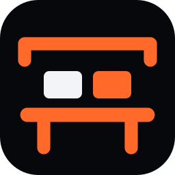

# Pitwall

A local-first sim racing coach and race engineer for the iPad next to your wheel.

<!-- --- lane install --- -->
<picture><source media="(prefers-reduced-motion: reduce)" srcset="docs/screenshots/01-drive-coach.png">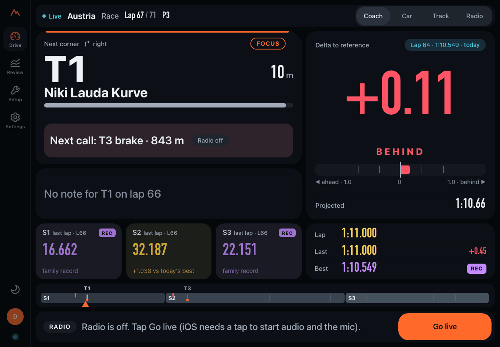</picture>

<sub>A recorded session streamed to Pitwall over UDP, captured in a desktop browser at iPad size; radio and language model off.</sub>
<!-- --- end lane install --- -->

## What it is

Pitwall runs on your computer (a Mac is recommended) and listens to the telemetry your racing game sends over the
network. It learns the circuit, compares every lap with your own reference lap metre by metre, and turns the
differences into short, measurable coaching: where you lost time, how much, and why. The screen next to your wheel
shows the next corner, the live delta and one thing to work on. A race engineer on the radio calls braking points
and answers questions.

All coaching is worked out by fixed rules from your telemetry. A language model (local or cloud) is optional: it
only rephrases facts Pitwall has already computed, every answer is checked against those facts, and Pitwall works
fully with the model switched off.

## Install

<!-- --- lane install --- -->
The quickest is one command (from v0.2.0).
It downloads and checks the latest release, installs it into `~/Pitwall` and keeps your sessions there when you
update with `uv run pitwall update`.

macOS and Linux:

```bash
curl -fsSL https://github.com/Moment-Up/pitwall/releases/latest/download/install.sh | sh
```

Windows PowerShell:

```powershell
irm https://github.com/Moment-Up/pitwall/releases/latest/download/install.ps1 | iex
```

What it does and its options: [Install with one command](docs/install.md#install-with-one-command). Or install it
one of these three ways:

### 1. Download a release by hand
<!-- --- end lane install --- -->

Each release on the [Releases page](https://github.com/Moment-Up/pitwall/releases) has one zip,
`pitwall-<version>.zip`, with the new dashboard already built. You need only [uv](https://docs.astral.sh/uv/) (it
installs Python 3.12 for you): no Node.js and no HeroUI Pro licence. Download `pitwall-<version>.zip` and
`pitwall-<version>.zip.sha256` from the latest release (not GitHub's "Source code" downloads) into a folder you keep,
for example `~/Pitwall` (not Downloads, Desktop or Documents: your data lives in the release folder), then, in that
folder:

**macOS and Linux**

```bash
shasum -a 256 -c pitwall-v0.1.0.zip.sha256   # must print OK (Linux: sha256sum -c pitwall-v0.1.0.zip.sha256)
unzip pitwall-v0.1.0.zip
cd pitwall-v0.1.0
uv sync --all-extras
uv run pitwall serve                         # dashboard at http://127.0.0.1:8770/
```

**Windows** (PowerShell, using the scripts in [scripts/windows](scripts/windows/README.md))

```powershell
(Get-FileHash .\pitwall-v0.1.0.zip -Algorithm SHA256).Hash -eq (Get-Content .\pitwall-v0.1.0.zip.sha256).Split(' ')[0]   # must print True
Expand-Archive .\pitwall-v0.1.0.zip -DestinationPath .
cd .\pitwall-v0.1.0
powershell -NoProfile -ExecutionPolicy Bypass -File scripts\windows\install.ps1
powershell -NoProfile -ExecutionPolicy Bypass -File scripts\windows\pitwall.ps1
```

Use the version you downloaded in place of `v0.1.0` (the first release). Always start Pitwall from the release
folder: it keeps your data in `data/` there. The full steps, including the firewall on Windows and moving your data
to the next release, are in [Install from a release](docs/install.md#install-from-a-release).

### 2. Let Claude Code set it up

> [!TIP]
> **Set up with Claude Code.** Unzip a release (or clone the repository), open that folder in
> [Claude Code](https://claude.com/claude-code) and run `/setup-pitwall`. It checks the prerequisites, installs
> Pitwall, runs a synthetic demo and `pitwall doctor`, and gives you your game's exact telemetry settings. Written
> for macOS and Windows. On Windows it drives the CI-tested scripts but has not yet been run end to end on a Windows
> PC.
>
> - It asks before it installs or changes anything.
> - It never asks for API keys, tokens or your HeroUI Pro login: you type keys into the dashboard yourself.
> - If Claude Code asks whether to enable this project's MCP server `qwen` (from `.mcp.json`), you can decline: it
>   is the maintainer's optional tool for a local model server, and setup does not use it.
>
> More: [Set up with Claude Code](docs/install.md#set-up-with-claude-code).

### 3. From source (developers)

```bash
git clone https://github.com/Moment-Up/pitwall.git && cd pitwall
uv sync --all-extras
cd web && npm ci && npm run build && cd ..   # classic dashboard (Node.js 20.19+ or 22.12+)
uv run pitwall serve
```

Building the new dashboard from source needs your own HeroUI Pro licence (see
[The two dashboards](#the-two-dashboards-and-heroui-pro)); without one you get the classic dashboard automatically.
On Windows, `scripts\windows\install.ps1` does these steps. Details:
[Install from source](docs/install.md#install-from-source).

### Try it without a game

In the release or repository folder:

```bash
uv run pitwall simulate                                                  # a SYNTHETIC session with known mistakes
uv run pitwall replay data/captures/synthetic-coaching-demo-2025.pwcap   # analyse it into the database
uv run pitwall report                                                    # print the coaching report
uv run pitwall send data/captures/synthetic-coaching-demo-2025.pwcap --speed 8   # with pitwall serve running: watch it live
```

The demo is ten generated laps in which the radio finds a braking habit, calls it until it is sorted, then reminds you
of the next one; `pitwall simulate` prints what to look for ([Try the demo](docs/install.md#try-the-demo-no-game-needed)).
It is labelled SYNTHETIC everywhere. Then point your game's UDP telemetry at the
computer's IP address, port 20777 (`pitwall serve` prints both), and drive:
[Connect your game](docs/install.md#connect-your-game). Without a language model, switch the AI engineer off in
Settings › AI engineer, or set `PITWALL_LLM_ENABLED=false` in `.env`. `uv run pitwall doctor` checks an install at
any time and prints a fix for each problem.

### Platforms

| | macOS, Apple Silicon | macOS, Intel | Windows 10/11 | Linux |
|---|---|---|---|---|
| Status | **Tested live** with F1 25 on PS5; CI runs the test suite | Should work; not run yet | **CI-tested on Windows** (GitHub runners), not yet validated live with a game on a Windows PC | Should work; not yet run with a game or by a user (each release is checked on a Linux CI runner, see below) |
| Telemetry, coaching, dashboard, CLI | Yes | Should work | CI-tested | Should work |
| Spoken questions (speech recognition) | Yes (Parakeet, built in) | Only with a whisper.cpp server (or sherpa-onnx installed by hand) | Yes, Parakeet on the CPU via sherpa-onnx (CI-installed, not yet tried on a Windows PC) | Only with a whisper.cpp server (or sherpa-onnx installed by hand) |
| Engineer voice on the computer | macOS voices, or the optional natural voice (Kokoro) | macOS voices | Windows' built-in voices (SAPI, CI-tested, not yet heard on a radio) | None (text) |
| Start at login | launchd (`scripts/pitwall-service.sh`) | launchd | Task Scheduler (`scripts/windows/service.ps1`) | No script yet |
| Install helpers | - | - | `install.ps1`, `firewall.ps1`, `smoke.ps1` | - |

On every platform typed questions work and the iPad or browser can speak with its own voice. The whisper.cpp path
is tested against a mock server only. Before a release is published, its zip is unzipped, installed and run with
synthetic telemetry on GitHub's Windows, macOS and Linux runners ([releasing.md](docs/releasing.md)): that shows it
installs and runs there, not that a game works.

### What you need

- **[uv](https://docs.astral.sh/uv/)**. It installs Python 3.12 for you.
- **A game that sends UDP telemetry** ([supported games](#supported-games)), on the same network as the computer.
  Assetto Corsa Competizione is the exception: it shares its telemetry only on the Windows PC that runs it, so
  Pitwall must run on that PC.
- About 0.7 GB of disk for the Python environment. Speech recognition downloads a model of about 2.5 GB the first
  time the radio is used, and the optional natural voice needs about 1 GB. Raw captures of real F1 25 sessions need
  about 400 MB per hour of driving (`PITWALL_RECORD_RAW=false` turns them off).
- Optional: a local model server (llama.cpp, LM Studio, Ollama, MLX or any OpenAI-compatible server) or a cloud API
  key, for the engineer's explanations. Not required.
- Optional: an iPad or phone, and [Tailscale](https://tailscale.com) if you want to talk to the radio from it (the
  microphone needs HTTPS).
- From source only: git and Node.js 22.12 or later (the classic dashboard also builds on 20.19 or later).

Full instructions, including game setup, the iPad, the radio and running Pitwall in the background:
**[docs/install.md](docs/install.md)**.

## Features

Each item below works today unless it is marked otherwise. [docs/features.md](docs/features.md) has a tour with
screenshots, and [docs/status.md](docs/status.md) has the full evidence.

**New in v0.2.0**, each with how far it has been tested (*recorded*: real game captures played back; *synthetic*:
generated data; nothing below has been run live on the rig yet):

- **Game selection**: tell Pitwall what you play; it says what that game sends, and each driver can have a usual
  game. Recorded (F1 25, Assetto Corsa) and synthetic (GT7, Forza).
- **Pace against the AI** (F1 25): your best lap against the typical AI car, and a suggested AI difficulty per track.
  Recorded (six PS5 sessions).
- **Technique and setup engineer**: racing line, braking and throttle, handling balance, and one setup change to try.
  Recorded (F1 25; the line also on GT7); lock-ups synthetic only.
- **Race strategy engineer** (F1 25): gaps, tyres, fuel, pit window, undercut, safety car and weather, on the radio
  and on Drive › Car. Recorded (a 71-lap race); safety car, VSC, rain and your own stop synthetic only.
- **Goals, streaks and weekly summaries** for every driver, and three things after every session. Recorded.
- **Reference choice and practice drills**: what the delta compares you with (your best, the family record or
  another driver's lap) and one-corner drills. Recorded through a development script.
- **Rig validation kit**: Setup › Validation and `pitwall validate`. Nothing passes until it is run live, by design.
- **One-line install and `pitwall update`**. End to end on macOS; Windows and Linux through CI only.
- **A calmer radio and a glanceable Drive**: one engineer, at most three messages a lap of the radio's own at normal
  intensity from every source together, in a calm part of the lap; only the spotter, a red flag and a puncture cut
  in; instant answers while moving; on track Drive shows only what helps at speed. Recorded over loopback and in a
  desktop browser.

The screenshots show the new dashboard, which comes prebuilt in every release. Built from source without a HeroUI Pro
licence, you get the classic dashboard instead (see [The two dashboards](#the-two-dashboards-and-heroui-pro)): it has
the same telemetry, coaching, radio, session review, setup and engineer features in a different layout, but not the
Drive › Coach, Drive › Track, Session complete, Review › Coaching and Review › Progress screens. The new dashboard has
been tested with recorded and synthetic sessions in a desktop browser. It has not yet been used on a real iPad during a
live session; the live PS5 tests so far used the classic dashboard.

**Drive**
- Coach screen: the next corner, distance to it, a braking cue, the live delta to your chosen reference, the
  projected lap time, sector times and one coaching point from the last lap. Cards (Ready, Session complete) wait for
  the car to stop; on track the status line shows one thing at a time with at most two chips.
- Reference choice: the delta compares you with your best (default), the family record, another driver's best or a
  saved lap, compatible laps only; practice drills on one corner from the Ready card or the radio. Recorded through a
  development script; not yet live.
- Car (pit wall) screen: speed, gear, inputs, track map, tyres and fuel, lap table.
- Track screen: the map follows the car and shows what the coach said about each corner.
- Game flags (for example a yellow flag) take over the status band. Unknown values show as `-`, never a guess.
- Live braking cues (Off, Focus, Markers, All): timed so the word lands on your reference braking point. Tested on
  synthetic and recorded data, **not yet validated live on track**.

**Radio and voice engineer**
- Push-to-talk on screen or on a wheel button (F1 25 "UDP Action" buttons: Controls > (your wheel's preset) > UDP
  Custom Actions; UDP Action 1 unless Setup › Controls says otherwise). The wheel button is read live from F1 25 on
  PS5; asking a question by push-to-talk has not yet been tested by a driver.
- Setup › Controls: which button does what on any wheel (23 researched templates or your own) in any researched
  game, with step-by-step mapping cards and a printable card. Research only; F1 25 buttons can be tested in the app.
- Fuel, tyres, lap times and radio commands are answered at once from telemetry. Analysis questions go to the
  language model if you have one, and to a fact-based answer if you do not.
- Lap summaries, strategy calls, goal lines and coaching wait for a calm part of the lap: off the brake, steering
  nearly straight and with time to finish before the next braking zone. At most two of them a lap at normal intensity
  (four at detailed), in a fixed order; braking cues, alerts and your answers do not count. While the car is moving
  every answer is instant, from the facts. You can say "Stop talking for two laps". Tested on replayed sessions;
  not yet heard in a live session.
- Speech recognition with Parakeet on Apple Silicon, and on Windows the same model family on the CPU through
  sherpa-onnx (installed by `uv sync --all-extras`; its model, about 660 MB, downloads the first time a radio
  connects; not yet tried on a Windows PC). A whisper.cpp server can be used instead on any platform; that path is
  tested against a mock server only.
- Talking without the wheel button: the screen button, Space on a Mac, a Bluetooth page turner, pedal or spare game
  controller paired with the iPad, or hands-free with a wake word ("Pitwall, what's my fuel?"). Hands-free is off
  until each device turns it on, listens only while the car is stopped unless the driver allows it while driving, and
  throws away everything not addressed to the radio. Synthetic and recorded evidence only: not yet tried on the rig.
- Voices: the Mac's `say` voices, Windows' built-in voices, the iPad's or browser's own voice, or an optional
  natural voice (Kokoro) on Apple Silicon. The natural voice is tested on synthetic phrases only, and the Windows
  voices in CI only; neither has been heard in a live session.
- A radio check over an iPad and one AirPod has been heard on hardware, using the classic dashboard's Radio page.
  The new dashboard's Go live and push-to-talk over Tailscale have not been tried on an iPad yet, and speaking
  questions from the iPad is still to be tested by a driver.

**Review and progress**
- Every session per driver, with a summary: best lap, clean laps, improvement, consistency, best sectors combined
  and corners ranked by time lost.
- Lap comparison on the same car, track and conditions: time gained or lost along the lap, a map coloured by where
  the time went, and per-corner detail.
- Coaching plan (this session's focus, repeats lap after lap, radio calls next run, drills, suggested AI level),
  Progress across sessions at one track and car, and Goals (goals, the week, streaks and badges). These pages are
  new and not yet used after a live session.
- Goals, streaks, badges and a weekly digest for every driver, and three things after every session (also in
  `pitwall report`, `pitwall recap` and `pitwall digest`). Tested on recorded captures; not yet live.
- Technique (Compare and Corners): racing line, brake and throttle, handling balance, and setup changes to try on
  Setup › Car setup (F1 25). Tested on recorded laps; lock-ups on synthetic data only.
- Ask the engineer about any session, on screen or with `pitwall ask`. `pitwall report` prints a Markdown report.
- Pace against the AI (F1 25): your best clean lap against the typical AI car's at the AI difficulty you raced,
  per track and car class over time, and a suggested AI level once you have raced a track at two or more levels.
  Uses only the game's own telemetry. Tested on recorded PS5 sessions, not yet live; the screens are in the new
  dashboard, and the engineer and radio answer "how am I doing against the AI?" with either dashboard.

**Track knowledge**
- Corners are learned from your own clean laps. In F1 25, sectors and marshal zones come from the game.
- Official corner names are shown only where a track sheet has been checked by hand. So far that is Austria.

**Setup**
- Game: tell Pitwall what you play (Setup › Game, or `uv run pitwall game set <id>`). It switches on that game's
  telemetry input (GT7: once you give the console's IP, or ask it to search the network) and lists, feature by feature, what the game sends and what it does not, never stronger than
  the [supported games](#supported-games) table. Screens and the engineer then say "Not sent by GT7" instead of
  leaving a gap unexplained or guessing. Tested with unit, synthetic and recorded data; not yet with a live GT7,
  Forza or Assetto Corsa console.
- Connect: the exact in-game telemetry settings with copy buttons, and live confirmation that packets arrive.
- Validation: a checklist of the live tests still pending on the rig; Pitwall collects the evidence while you drive
  and you confirm. Reports stay on the computer and never change what Pitwall claims by themselves.
- Rig walkthrough for the Fanatec GT DD Pro (5 Nm, or 8 Nm with the Boost Kit) and CSL pedals, for F1 25 and
  GT7: one menu item at a time, with the source and confidence of every value. A rig check reads your last
  session's telemetry. Its thresholds are heuristics, and the load-cell checks are unverified.
- Car setups for F1 25: a catalogue of 454 published setups with recommendations by track, session, weather and
  style. No recommended setup has yet been driven and checked by Pitwall.

**Race engineer (F1 25 races)**
- Gaps, tyres, fuel, the pit window, undercut, safety car and weather on Drive › Car and the radio, and a Race tab in
  Review. Tested on recorded races; safety car, VSC, rain and your own stop on synthetic data only; not yet live.

**Drivers**
- Profiles for everyone who shares the rig. Sessions, reference laps and personal bests belong to the driver in
  the seat. Skill level and coaching intensity set how much the coach says and how simply.
- Switching driver mid-session hands the seat over and splits the session if laps were already driven. This is
  verified on synthetic streams only.

**Multi-game**
- F1 25 and Gran Turismo 7 are tested live on PS5 (GT7: races on 2026-10-11; its session and lap handling was
  fixed since and re-checked on the recordings of those races). Assetto Corsa's telemetry has been confirmed from a
  PS5, but its laps and coaching have not yet been run through Pitwall end to end. Forza is implemented but not yet
  tested with the real games. Assetto Corsa Competizione is read on its Windows PC (partial; generated data and a
  tester's live checks, no Pitwall recording yet). See [Supported games](#supported-games).

**Private and local**
- Telemetry, sessions and captures stay in a SQLite database and a folder on your computer.
- Devices on your network need an access token. Over Tailscale your own login is recognised.
- Cloud models are off until you turn them on and accept a privacy notice. Only the question, your last few
  exchanges and a fact sheet are sent, never raw telemetry or audio, and driver names are replaced by "the driver"
  (on by default). Cloud providers are tested against mock servers only; no live cloud call has been made yet.

## Supported games

The rows come from [`src/pitwall/capabilities.py`](src/pitwall/capabilities.py), except the last one, which is the
Connect page's record-only option; the research-only video-capture row is left out. Run `uv run pitwall capabilities`
for the full list with notes.

| Game | Platform | Status | Evidence |
|---|---|---|---|
| F1 25 (UDP format 2025) | PS5 | **Tested live** | Real races at Austria on 2026-10-10: about 190k packets, 0 rejected, lap and sector times match the game exactly. A recorded excerpt is part of the test suite. |
| F1 25 (UDP format 2025) | PC, Xbox Series | Built from the official spec | Same packets as PS5 according to EA's spec. Not yet tested on these platforms. |
| F1 25 2026 Season Pack (UDP format 2026) | PC, PS5, Xbox Series | Built from the official spec | Synthetic tests only. |
| F1 24 and older (format 2024) | All | Not supported | Rejected with a clear message. Set the game's UDP Format to 2025 or 2026. |
| Gran Turismo 7 | PS5 | **Tested live** | Races on the owner's PS5 on 2026-10-11: 277,467 packets, 0 rejected, every lap time equal to the game's own to the millisecond. Menus, replays and car resets had split those races into extra sessions and lost some laps; that is fixed and re-checked on the same recordings, and recorded excerpts are part of the test suite. The game sends no lap distance, so distance is worked out from the car's velocity (within about 0.2% per lap). |
| Gran Turismo 7 | PS4 | Built from community docs | The same packets as the PS5 according to the community docs. Not tested on a PS4. |
| Forza Motorsport (2023) | Xbox Series, PC | Built from community docs | Synthetic tests only. |
| Forza Horizon 4 / 5 | Xbox, PC | Built from community docs | Synthetic tests only. Free roam has live data but no laps. |
| Assetto Corsa (PS4 version) | PS5 (backward compatibility) | Tested on a recording | A probe script confirmed live that the game streams telemetry on a PS5 (2026-10-11), and Pitwall's decoder is tested on that recording. Laps, timing and lap coaching through the full app are not yet confirmed. |
| Assetto Corsa | PS4 | Built from community docs | Others have confirmed the protocol on PS4. Not tested by Pitwall on a PS4. |
| Assetto Corsa | PC | Built from community docs | Not yet tested against the PC game. |
| Assetto Corsa | Xbox One | Not supported | The Xbox One version has no telemetry. |
| Assetto Corsa Competizione | PC (Pitwall on the same Windows PC) | Partial | Read from ACC's shared memory on the gaming PC, built from Kunos' official document and tested with generated data only. A tester (Ed) checked pedals, steering, speed, gear and the track and car names live with his own build; no Pitwall recording of ACC exists yet. Sector times, fuel, tyre temperatures, flags and the other cars are not read yet. |
| Assetto Corsa Competizione | PS5, Xbox Series | Not supported | No telemetry on consoles. Checked on a PS5 on 2026-10-11: nothing listens on its telemetry ports. |
| iRacing | PC | Not in Pitwall yet | Its SDK can only be read on the gaming PC itself; no reader yet. |
| Other games (for example Project Motor Racing) | Any | Records packets only | Raw packets are saved so a decoder can be written later. No analysis. |

What one game and platform sends, feature by feature (sector times, tyre wear, fuel, ...), is on Setup › Game and in
`uv run pitwall game show <id>`; it is built from the same rows and is never stronger than them.

The newer analyses need data only some games send:

| Feature | F1 25 | Gran Turismo 7 | Forza | Assetto Corsa | ACC (PC) |
|---|---|---|---|---|---|
| Racing line (Compare, Corners) | Recorded (PS5) | Recorded (a PS5 capture) | Synthetic only | Position decoded on the PS5 recording; no lap stored end to end yet | Synthetic only |
| Handling balance, lock-ups and wheelspin | Recorded (PS5); lock-ups synthetic only | No: Pitwall reads tyre slip from F1 25 only | No (same) | No (same) | Synthetic only, and only after checks while you drive settle ACC's slip and yaw channels (no documented units) |
| Race strategy engineer | Recorded (PS5 races) | No (F1 25 only) | No | No | No |
| Pace against the AI | Recorded (PS5) | No (F1 25 only) | No | No | No |

None of these has been run live yet.

**Status words.** *Tested live*: checked end to end with the real game on that platform. *Tested on a recording*:
checked against real game output that was recorded. *Built from the official spec* or *community docs*: written
from the protocol documentation and tested with generated (synthetic) data only. *Partial*: Pitwall reads part of
what the game sends, tested with generated data only. Synthetic tests prove the algorithms, not that a game works. A
tester's own live check is reported as such, never as Pitwall evidence. The platform in this table is where the game runs; Pitwall itself runs on the
computer that receives its telemetry (see [Platforms](#platforms)).

## Screenshots

These show the new dashboard at iPad (landscape) and phone screen sizes, captured in a desktop browser. All
telemetry comes from real F1 25 sessions recorded on a PS5. The driver names are demo profiles. Three screens (rig,
car setup, radio settings) show no telemetry. They were taken with v0.1.0: in v0.2.0 the Ready and Session complete
cards, Review › Coaching and Progress changed, and Review › Goals, the session's Race tab, Setup › Game and Setup ›
Validation are new; those screenshots are still to be retaken.

<table>
<tr>
<td width="50%">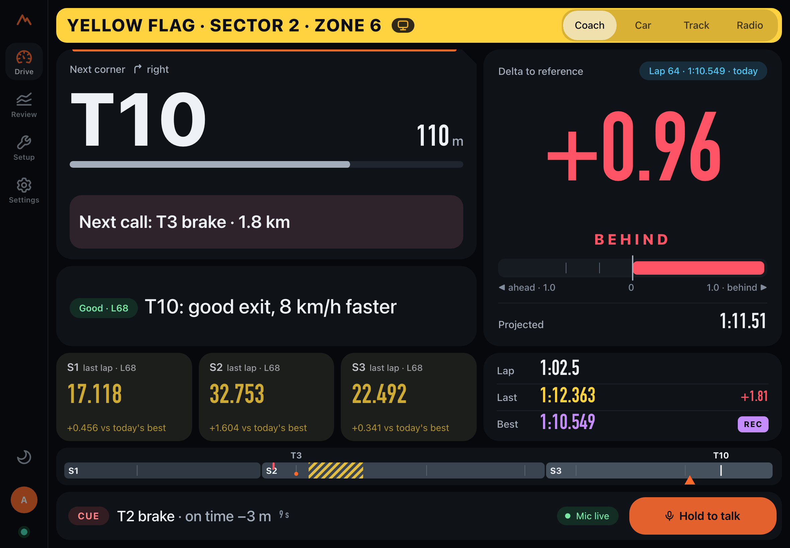<br><b>Drive › Coach, yellow flag.</b> The flag takes over the status band; the delta and coaching keep running.</td>
<td width="50%">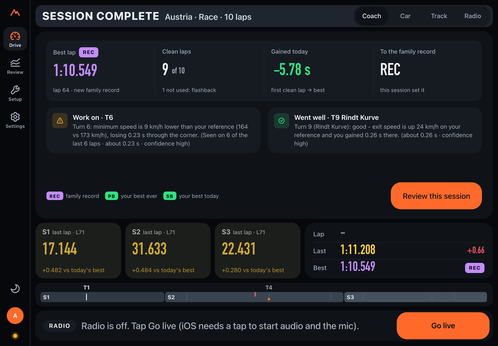<br><b>Session complete.</b> Best lap, clean laps, time gained, one thing to work on and one that went well.</td>
</tr>
<tr>
<td>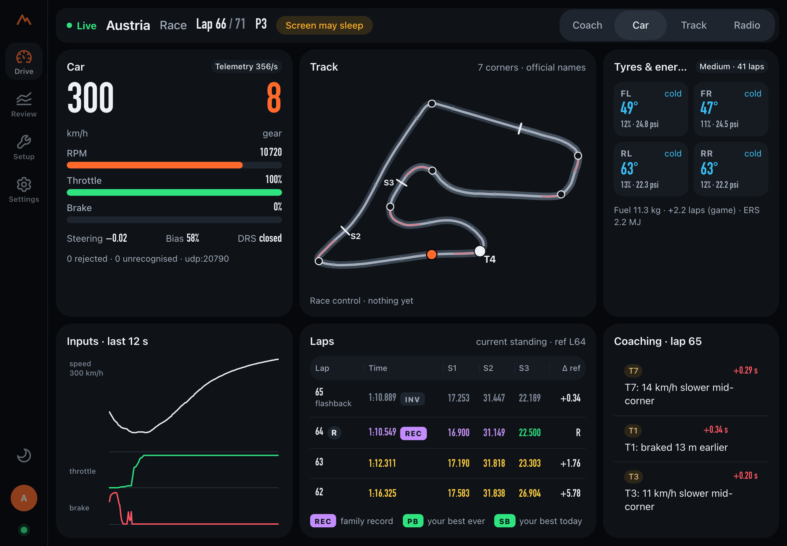<br><b>Drive › Car.</b> Speed, gear and inputs, the track map, tyres and fuel, laps and the last lap's coaching.</td>
<td>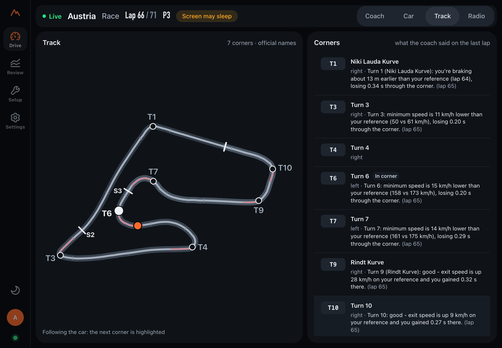<br><b>Drive › Track.</b> The map follows the car and shows what the coach said about each corner.</td>
</tr>
<tr>
<td>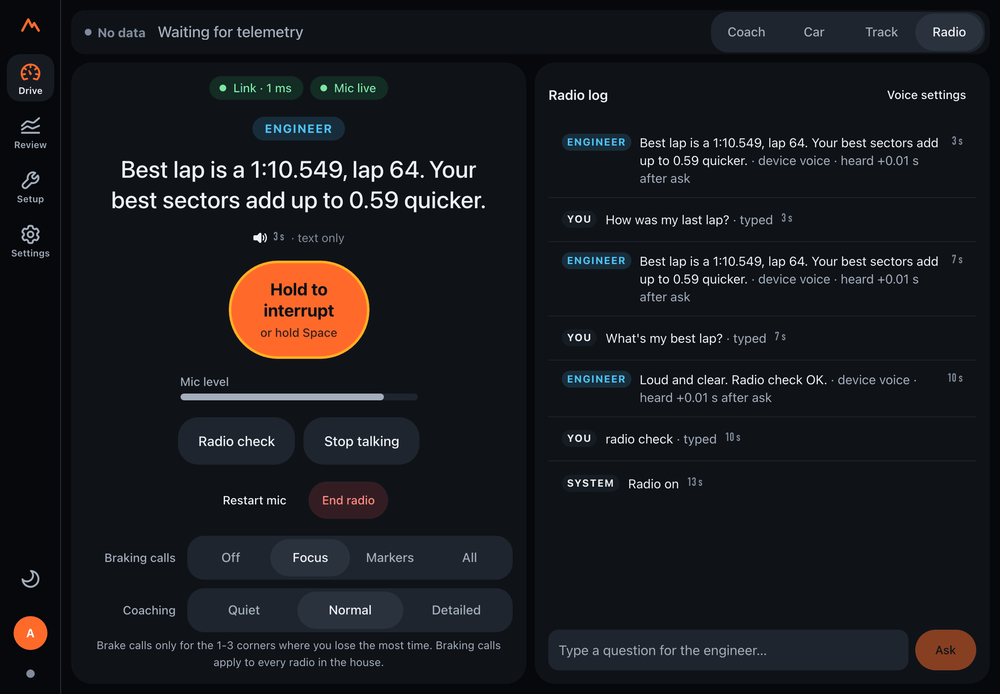<br><b>Drive › Radio.</b> The engineer between runs, answering typed questions. No language model was running, so these are the built-in fact-based answers.</td>
<td>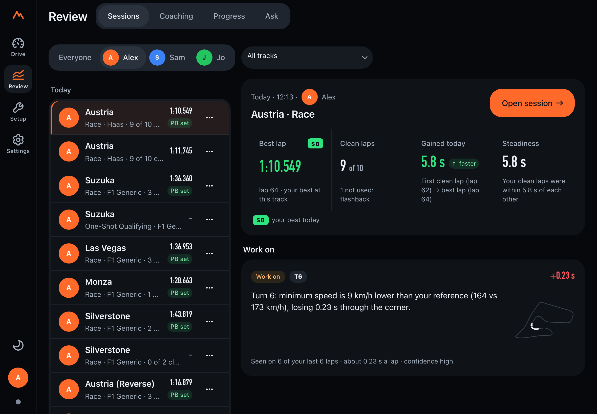<br><b>Review › Sessions.</b> Every session for the selected driver, with a preview of the selected one.</td>
</tr>
<tr>
<td>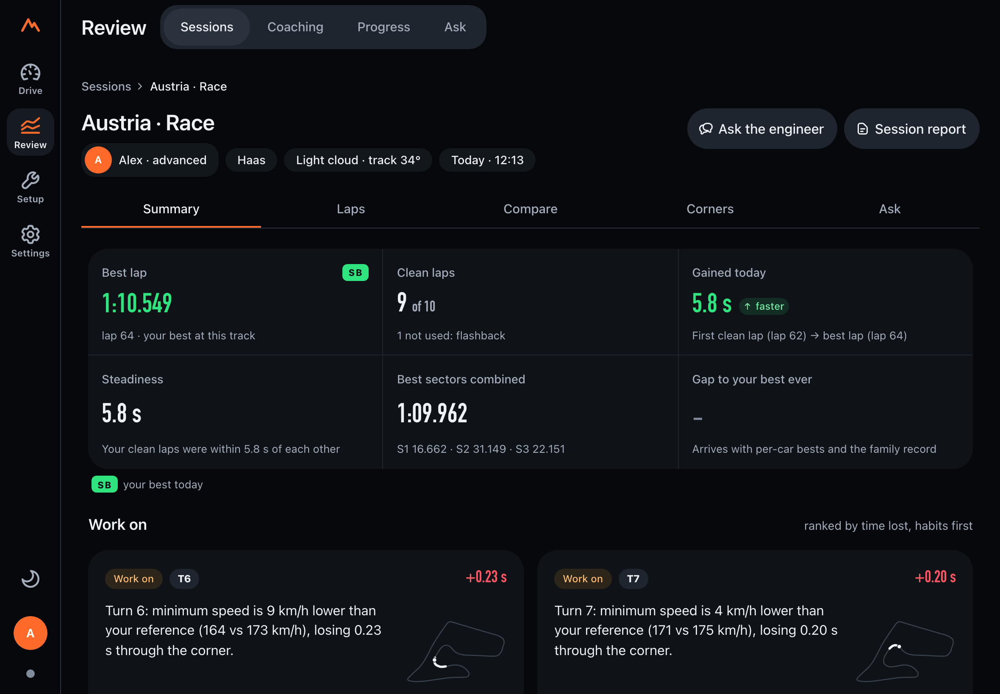<br><b>Session summary.</b> Best lap, clean laps, consistency, best sectors combined and corners ranked by time lost.</td>
<td>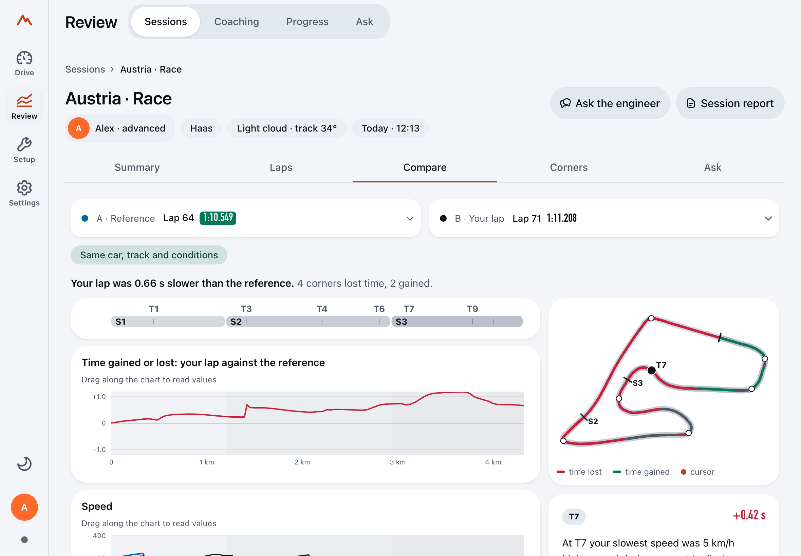<br><b>Compare (light theme).</b> Two laps on the same car and track: where time was gained or lost, on a graph and on the map.</td>
</tr>
<tr>
<td>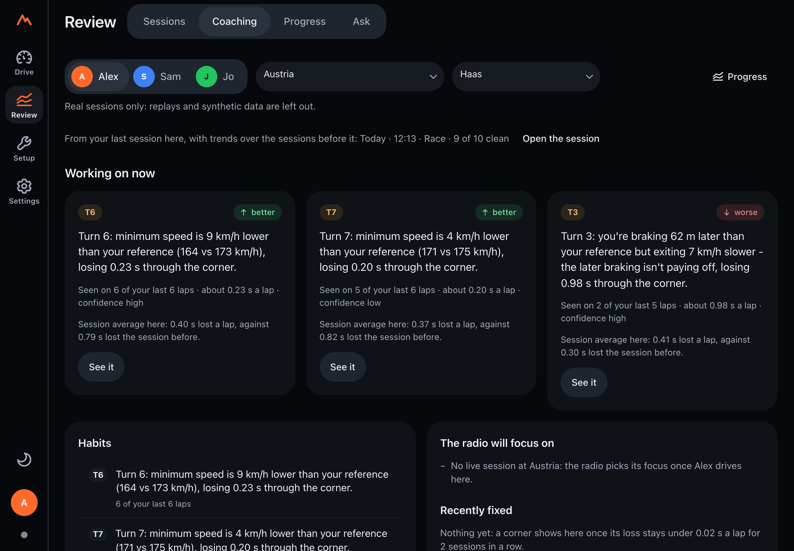<br><b>Coaching plan.</b> The corners to work on now, their trend over sessions, habits and the radio's focus.</td>
<td>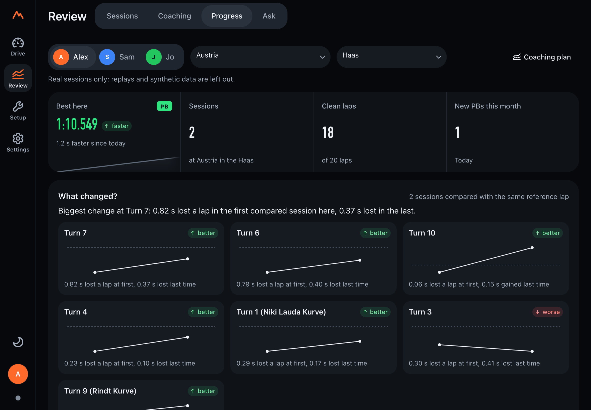<br><b>Progress.</b> Personal best, sessions, clean laps and how the time lost at each corner changed.</td>
</tr>
<tr>
<td>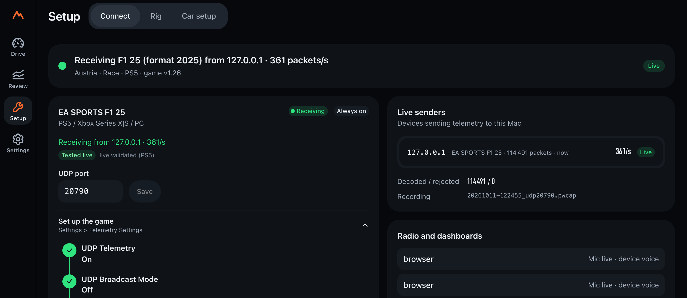<br><b>Setup › Connect.</b> The in-game telemetry settings and confirmation that packets are arriving. Here a recording was streamed to test port 20790; in the game use 20777.</td>
<td>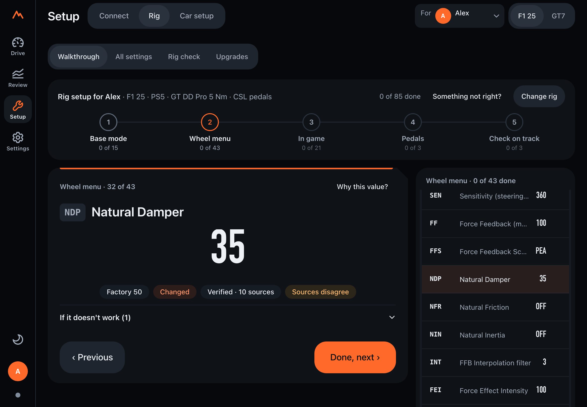<br><b>Setup › Rig.</b> The wheel base walkthrough, one menu item at a time, with the recommended value and how well sources agree. No telemetry.</td>
</tr>
<tr>
<td>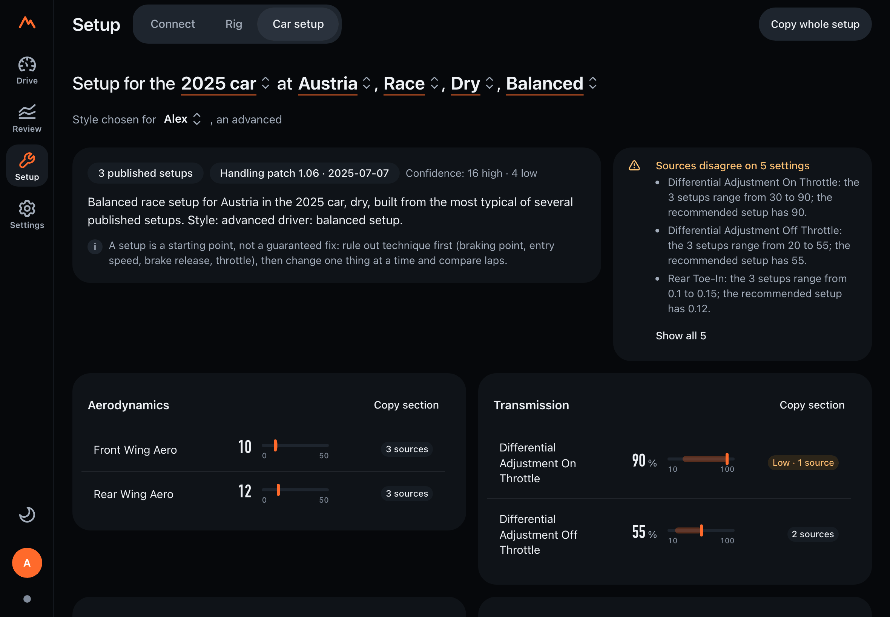<br><b>Setup › Car setup.</b> A recommendation built from published setups, with confidence per value and disagreements called out. No telemetry.</td>
<td>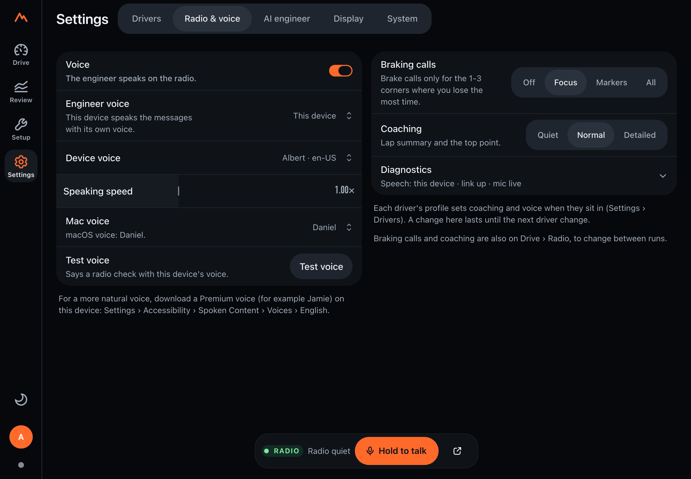<br><b>Settings › Radio &amp; voice.</b> Who speaks, which voice, speed, braking calls and how much coaching. No telemetry.</td>
</tr>
<tr>
<td>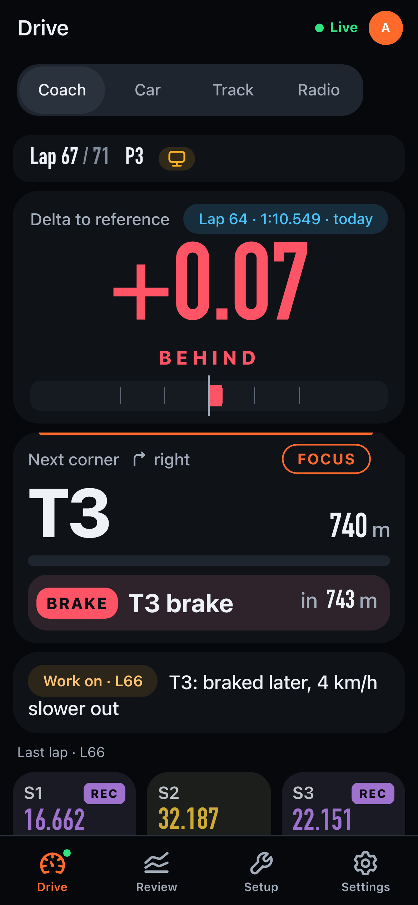 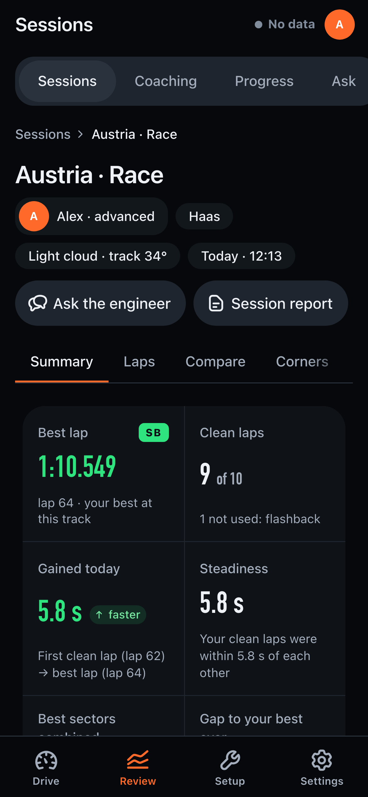<br><b>On a phone.</b> Drive › Coach and a session summary.</td>
<td></td>
</tr>
</table>

## The two dashboards and HeroUI Pro

The screenshots show the **new dashboard** (`web-react/`). It is built with HeroUI Pro, a commercial component
library. **Every release has it prebuilt**, so you can use it without a HeroUI Pro licence and without Node.js.
**Building it from source needs your own HeroUI Pro licence.** Without one, `npm ci` in `web-react/` seems to
succeed, but the build then fails with `Can't resolve '@heroui-pro/react/css/...'`.

From source without a HeroUI Pro licence, build the **classic dashboard** (`web/`, Svelte). Pitwall serves it
automatically whenever the new one is not built. It has Live, Sessions, Engineer, Radio, Setup (rig walkthrough and
rig check), Car setup, Drivers, Connect, Settings (including the AI engineer) and Status. It does not have the newer
coach-first Drive screens or Review › Coaching and Progress, and it looks different from the screenshots. It
receives fixes only.

If you hold a HeroUI Pro licence, sign in and build the new dashboard:
`cd web-react && npx heroui-pro@latest login && cd .. && make web-react`. Pitwall then serves it at `/` (see
[web-react/README.md](web-react/README.md)).

## Commands

| Command | What it does |
|---|---|
| `pitwall serve [--host] [--port] [--no-udp] [--verbose]` | Dashboard and API, the live telemetry listener and raw recording |
| `pitwall simulate [--format 2026] [--out FILE]` | Write a SYNTHETIC F1 capture with known, injected mistakes |
| `pitwall replay <file> [--speed]` | Process a capture into the database without the server |
| `pitwall send <file> [--host] [--port] [--speed]` | Stream a capture over UDP, as a console would |
| `pitwall sessions [--limit]` / `pitwall report [id]` | List sessions / print a Markdown session report |
| `pitwall ask "Where am I losing time?" [--session ID] [--no-llm] [--show-facts]` | Ask the engineer about the latest session (uses the `.env` model unless `PITWALL_LLM_ENABLED=false` or `--no-llm`) |
| `pitwall llm-check` | Find and test the model server set in `.env` or the environment (not one chosen in the settings page) |
| `pitwall doctor [--json] [--no-llm]` | Check this computer's setup (ports, firewall, dashboard, voice, AI, telemetry, last update check) with a fix for each problem |
| `pitwall game list` / `show [<id>]` / `set <id>` / `clear` | The game catalogue, what a game sends, and the household's selection |
| `pitwall technique [SESSION_ID] [--ref LAP_ID] [--json]` | Racing line, brake and throttle, handling balance and setup suggestions for a session |
| `pitwall goals [--suggest]` | A driver's goals with their progress (and suggestions) |
| `pitwall recap [SESSION_ID]` | A session's three things: went well, one to work on, progress |
| `pitwall digest [--week DATE] [--html FILE]` | A driver's weekly digest as Markdown, or the printable page |
| `pitwall ai-pace backfill [--captures DIR] [--dry-run]` | Fill pace against the AI for older F1 sessions from their raw captures (refuses while a server answers on the HTTP port) |
| `pitwall validate list` / `show` / `report` / `catalog` | Rig validation runs (started from Setup › Validation) and what each test asks |
| `pitwall update [--check] [--rollback]` | Update a release install to the latest release (a git checkout updates with `git pull`) |
| `pitwall capabilities` | Print the game and platform support matrix |
| `pitwall token` | Print the access token URL for phones and tablets |

Run them with `uv run` from the release or repository folder. Settings use the `PITWALL_` prefix and can live in a
`.env` file in the folder you start Pitwall from: see [.env.example](.env.example).

## How it works

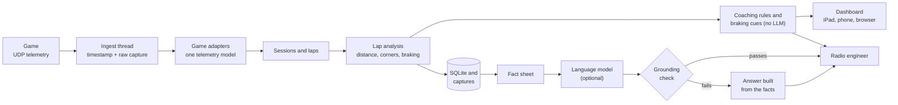

The UDP thread only timestamps, records and decodes packets; it never waits for the disk, the database or a model.
Each finished lap is resampled to a 1 m grid by lap distance and compared with your reference lap. Fixed rules
turn the differences into coaching. The model never sees raw telemetry: it receives a fact sheet with numbered
facts, and an answer is used only if every number in it comes from the facts it was given. See
[docs/architecture.md](docs/architecture.md).

## Documentation

| Document | What it covers |
|---|---|
| [Install](docs/install.md) | Releases, Claude Code, from source, games, iPad, radio, background service, updating, troubleshooting |
| [Windows scripts](scripts/windows/README.md) | Install, run, firewall, background service and smoke test on Windows |
| [Features](docs/features.md) | A tour of each screen and how the coach decides what to say |
| [Status](docs/status.md) | What works, what is tested and how, one row per feature |
| [History](docs/history.md) | Each development lane's own notes and evidence, kept as written |
| [Changelog](CHANGELOG.md) | What changed in each release, for drivers |
| [Validation](docs/validation.md) | The evidence tiers and the live test procedure |
| [Architecture](docs/architecture.md) | Threads, data model, analysis pipeline, storage, security |
| [AI engineer models](docs/llm-providers.md) | Local and cloud models, privacy, costs |
| [Radio setup](docs/radio-setup.md) | iPad, one AirPod and wheel push-to-talk |
| [Radio protocol](docs/voice-protocol.md) | The `/ws/radio` WebSocket protocol |
| [Rig setup](docs/rig-setup.md) | The wheel and pedal walkthrough and the rig check |
| [Game compatibility research](docs/research/game-compatibility.md) | Every game and platform considered, with sources |
| [Releasing](docs/releasing.md) | How a release zip is built, checked and published |
| [Licences](docs/licences.md) | Dependency and data licence register |
| [Design decisions](docs/decisions/README.md) | Architecture decision records |
| [New dashboard](web-react/README.md) | Layout of the React dashboard and the HeroUI Pro setup |

## Project status

Pitwall is under active development. Every claim is tied to one of three evidence tiers:

- **Synthetic**: generated telemetry with known, injected mistakes. Proves the algorithms find them.
- **Recorded**: real game output captured to a file. Proves the decoder copes with what the game really sends.
- **Live**: the real game on a real platform, end to end.

Synthetic results are never presented as game compatibility. Synthetic sessions are labelled SYNTHETIC in the
dashboard and kept apart from real track data. Windows has its own tier for now: CI-tested on Windows (GitHub
runners), not yet validated live with a game on a Windows PC. [docs/status.md](docs/status.md) lists what is
verified and what is not, and [docs/validation.md](docs/validation.md) explains how to test a game on your own
setup.

## Licence and credits

**Pitwall does not have an open-source licence yet, so all rights are reserved. You are welcome to download, install
and use it for your own racing; a formal licence will follow.** The repository has no LICENSE file yet, and
`pyproject.toml` says "Proprietary - all rights reserved". Third-party components below keep their own licences,
and none of them is relicensed by Pitwall.

**HeroUI Pro is separately licensed and not covered.** HeroUI Pro (`@heroui-pro/react`, © NextUI Inc.) is a
commercial component library under its own HeroUI Pro License Agreement. Its source is never included in this
repository, and Pitwall's terms (now or later) do not cover it or grant any right to it: building the new dashboard
from source needs your own HeroUI Pro licence. The dashboard prebuilt in each Pitwall release contains compiled
HeroUI Pro components, distributed only as part of the Pitwall application under the owner's HeroUI Pro licence;
they may not be extracted or reused on their own. `THIRD_PARTY_NOTICES.txt` in each release lists the licences of
the dashboard's components.

Third-party work Pitwall uses or relies on:

- **Pits n' Giggles** track segments and F1 2025 track maps, by Ashwin Natarajan. MIT licence. Shipped as data in
  `src/pitwall/trackdata/third_party/pits_n_giggles/` with its licence and provenance.
- **Parakeet TDT 0.6B v3** speech recognition model by NVIDIA
  ([CC BY 4.0](https://creativecommons.org/licenses/by/4.0/)), in the MLX conversion
  mlx-community/parakeet-tdt-0.6b-v3, run with **parakeet-mlx** (Apache-2.0). Downloaded from Hugging Face on first
  use; not included.
- **Parakeet TDT 0.6B v2** speech recognition model by NVIDIA
  ([CC BY 4.0](https://creativecommons.org/licenses/by/4.0/)), in the int8 ONNX conversion
  csukuangfj/sherpa-onnx-nemo-parakeet-tdt-0.6b-v2-int8, run with **sherpa-onnx** (Apache-2.0, ONNX Runtime bundled,
  MIT) on Windows. Downloaded from Hugging Face on first use; not included.
- **Kokoro-82M** voice model by hexgrad (Apache-2.0), in the MLX conversion by mlx-community, run with
  **mlx-audio** (MIT) and **misaki** (Apache-2.0). Installed by `scripts/setup-tts.sh`; not included.
- **HeroUI** (`@heroui/react`, `@heroui/styles`), Apache-2.0 (per their LICENSE files). **HeroUI Pro**
  (`@heroui-pro/react`, © NextUI Inc.) is commercial and separately licensed, see above.
- **EA SPORTS F1 25 UDP specification**, published by EA for third-party telemetry apps. Excerpts are reproduced
  in `docs/research/f1-udp-spec.md` so the decoder can be checked against them; that text belongs to EA and is not
  covered by any Pitwall licence. Other games' protocols are implemented from community documentation listed in
  `docs/research/`.
- **ACC Shared Memory documentation** (v1.8.12) by Kunos Simulazioni, published for third-party apps on the
  assettocorsa.net forum. Pitwall's ACC decoder is written from it, restated in our own words in
  `docs/research/acc-shared-memory-spec.md`; the document remains Kunos'.
- **Ed (Pitwall tester)** wrote the first ACC adapter, reader and track-length table, which Pitwall's ACC support
  started from, and checked them live in ACC on his PC.
- **Car setup values** published by F1Laps community members, RacingGames.gg, PPE.pl, Last Word On Gaming,
  Gamosaurus and a public Google Sheet, each attributed and linked in `src/pitwall/carsetup/data/f1_25_setups.json`.
  Only the values are recorded; the sources' content remains theirs and is not covered by any Pitwall licence.
- Open-source libraries, including React (MIT), React Aria (Apache-2.0), Recharts (MIT), Motion (MIT), Svelte
  (MIT), uPlot (MIT), FastAPI (MIT), Uvicorn (BSD-3-Clause), Pydantic (MIT), NumPy (BSD-3-Clause), SciPy
  (BSD-3-Clause), the Anthropic Python SDK (MIT) and zstandard (BSD-3-Clause). Dependencies, their versions and
  licences are listed in the dependency and data register, [docs/licences.md](docs/licences.md).

Pitwall is not affiliated with or endorsed by Electronic Arts, Codemasters, Formula 1, Sony Interactive
Entertainment, Polyphony Digital, Microsoft, Turn 10, Playground Games, Kunos Simulazioni, iRacing, Straight4
Studios, Fanatec or Apple. Their names are used only to say which games and hardware Pitwall works with, and all
trademarks belong to their owners.
