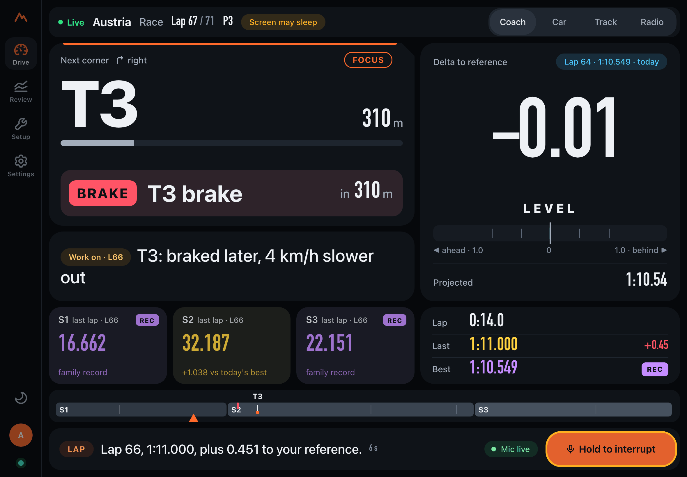

# Pitwall features

A tour of what Pitwall does, screen by screen. The screenshots show the new dashboard (`web-react/`) at iPad
landscape size in a desktop browser, with telemetry from real F1 25 sessions recorded on a PS5. The driver names
are demo profiles. Every [release](install.md#install-from-a-release) has the new dashboard prebuilt. The classic
dashboard (`web/`), which you get when you build from source without a HeroUI Pro licence, covers most of the same
ground with a different layout; the [last section](#the-classic-dashboard) maps one to the other.

**Evidence.** Pitwall separates three kinds of evidence: *synthetic* (generated telemetry with known mistakes),
*recorded* (real game output captured to a file) and *live* (the real game, end to end). The new dashboard has been
tested with recorded and synthetic sessions in a desktop browser, not yet on a real iPad during a live session.
Where a feature has less evidence than that, this page says so. [status.md](status.md) has the full record.

- [Drive](#drive)
- [Radio](#radio)
- [Review](#review)
- [Setup](#setup)
- [Settings](#settings)
- [What the radio says](#what-the-radio-says)
- [How the coach decides what to say](#how-the-coach-decides-what-to-say)
- [Pace against the AI](#pace-against-the-ai)
- [How the race engineer makes strategy calls](#how-the-race-engineer-makes-strategy-calls)
- [Car health: tyres, brakes, engine, fuel](#car-health-tyres-brakes-engine-fuel)
- [The AI engineer](#the-ai-engineer)
- [The classic dashboard](#the-classic-dashboard)

## Drive

Drive is the screen next to your wheel. It reads only live telemetry and the radio, so it works with no language
model at all. Values Pitwall does not know show as `-`, and synthetic data is labelled.

**What your game sends.** A `-` means "not known right now": the value has not arrived yet. Data the game never
sends is different, and once Pitwall knows the game ([Setup › Game](#game)) the screens say so in words where a
whole slot is missing: for example the sector cells read "Sectors · Not sent by GT7" in Gran Turismo 7, the Car
page names the tyre, fuel and ERS data your game does not send (or Pitwall does not read yet), and the delta is
marked "estimated" where Pitwall works out the lap distance itself. The words describe the data on screen: the game
that is sending right now, else the one you selected. Drive stays glanceable, with no banners: if a different game
than the one you selected is sending, the status line says so only while the car is stationary, and the other pages
show an alert with a button to switch.

### Coach

The next corner, how far away it is, and a braking cue when one is due. On the right, the live delta to your
reference lap, a level gauge and the projected lap time. Below, the corner point from your last lap ("Work on"
or "Good"), the last lap's sectors and the lap times. The radio strip at the bottom shows what the engineer last
said and has the push-to-talk button.

Game flags take over the status band: here a yellow flag in sector 2, also hatched on the track ribbon at the
bottom. The delta and the coaching keep running.

**Moving or stopped.** On track Drive shows only what helps at speed: the status band or line, at most two chips,
the next corner (FOCUS, or DRILL while a drill runs), the delta and a short coaching line. Cards, the game mismatch
line and the full coaching text wait for the car to stop (under 3 km/h for 1.5 s, or the data going quiet; it counts
as moving again above 8 km/h, so nothing flickers in the pit lane).

**The status line** shows one thing at a time, in this order: offline, no data, no signal, red flag, safety car or
VSC, yellow, blue, pit lane, chequered flag, session complete, another game's data (stopped only), ready, then the
normal line (track, session, lap and position). Strategy, goals, drills, pace against the AI and validation never
take it over. Beside it, at most one short-lived chip (6 s): a penalty or contact of your own first, then a goal
reached, a flashback, pit entry or exit, a fastest lap, then a reference notice ("Delta to Sam's best from the next
lap"); and, on an iPad's normal line, the DRILL chip while a drill runs. On a phone or under a band only one chip
shows, and SYNTHETIC or REPLAY become icons (their words stay in the accessible label).

**Ready card** (before a session and between runs, stopped only): who is in the seat; *Target*: your best here (or
the last run between runs: best lap, clean laps, time gained), the family record and its holder, the delta reference
and one goal in scope; *Today*: the radio's calls for this run ("Radio calls: T6, T9, T1"), up to two FOCUS corners
and the braking calls mode, or, between runs, "Last lap:" with the last lap's point. While a drill runs, or its result
waits for Done, that column is the drill.

**Session complete** (stopped only): four tiles (best lap with its REC or PB tag, clean laps, gained today, and the
gap to the family record, or "Laps compared" when this session set it), one line of pace against the AI in an F1 race,
[Today's 3 things](#todays-3-things) and at most two new badges. Each fact shows once: a personal best named in Went
well is not repeated by the tile tag, Progress or a badge. When a drill ran in the session, its result takes the
Work on slot. Without telemetry Drive shows what to check plus a button to try the synthetic demo.

**Goals on Drive.** While you drive, a reached goal shows only as a 6-second `GOAL REACHED` chip (a penalty or contact
of your own wins over it; it wins over a flashback, a pit message and a fastest lap); nothing else moves on track. No
animation and no sound.

Evidence: the Drive rules are tested on recorded and synthetic snapshots, and the card fit was measured in a desktop
browser at 1180 x 820, 1133 x 744, 768 x 1024 and 390 x 844 before the reference control and the drill block joined
the Ready card (not re-measured since); not yet on an iPad during a live session.

**Delta to.** The label above the delta is a control: what the delta, braking calls, corner comparison and lap
coaching measure against. *Your best* (the default), the *Family record*, another driver's best (*Sam's best*) or
a saved lap. When the family's best lap in your conditions is not the family record (the record was set in the wet,
or with another assist), it is called *Best in these conditions*: "Family record" always means the REC lap. Only
compatible laps are offered (same game, track, layout, car, wet or dry, and assists); a choice
that is not available says why, for example "Sam's laps here used a different braking assist". The choice is kept
per driver, for every track or for one track. It changes while the car is stopped; on track only *Back to your
best* is offered, and it applies from the next lap. A choice made before the session is in place from the first
lap when Pitwall knows the track and the car. Against another driver's lap the coaching names them ("Sam carries 6
km/h more through the slowest point"), and braking calls never go later than your own braking point at that corner;
a corner where you have no braking point of your own gets no call. Ask the radio "who am I compared with?" to hear
it.

**Practice drills.** From the Ready card between runs (a suggested drill under "Last lap:", or *Choose a corner…*),
a Work on point in Review, or the radio ("start a drill on turn 3"), pick a corner and a skill:
brake point (within 5 m before the point; past it counts only when the corner was faster), minimum speed (3 km/h
more than usual, never above the best speed driven there), exit speed, or entry speed (consistency, measured
against your own laps). For the next laps (5 by default) the radio and the braking calls talk only about that
corner, Drive shows a `DRILL · T3 · 3/5 · 2 ✓` chip, and each lap gives one line ("Turn 3 drill, 2 of 5: on the
point. 2 hits."). Race starts from the grid, resets to the track, pit laps and safety-car laps are not counted, and
a change of car, wet or dry, or assists ends the drill. The Ready card then shows the result (hits, the best attempt
and the trend) until you press Done, also after a driver change. Drills run in your own live session at a track
Pitwall has learnt (three clean laps). The tolerances and steps are heuristics from recorded F1 25 laps.

Reference choice and drills are tested on synthetic data and on recorded F1 25 laps replayed through the pipeline;
they are **not yet validated live**.

### Car

The pit wall view: speed, gear, throttle, brake and steering, the track map with the car's position, tyres and
fuel, the lap table and the last lap's coaching.

In an F1 25 race of 8 laps or more the inputs tile becomes a **Strategy** tile (in a shorter sprint the pit, undercut
and fuel rows would never change, so the inputs trace keeps its place): the gap to the car ahead and behind (with the
trend, "close" within a second and DRS range), the pit window and the best lap to stop, the undercut on the car ahead
and the threat from behind (the laps to go when no stop is needed), the fuel margin to the flag (with how long to
lift and coast when you are short), and the weather forecast ("after the flag" when a change comes too late to
matter). Under a safety car or VSC the weather row shows what a stop costs now against under green. Amber is kept
for what to act on or watch now. The footer shows the newest call while it holds (up to two lines). Numbers that
come from the game's own tyre model say "(game)", rules of thumb say "(estimate)", and anything not yet known is
`-`. A driver whose profile asks for simple wording gets plain words ("Laps to go", "close", "lift early"). Race strategy is tested on recorded PS5 races and synthetic ones; **not yet validated live**, and safety car,
rain and your own pit stop are synthetic only (see [how the race engineer makes strategy
calls](#how-the-race-engineer-makes-strategy-calls)).

The pit window row also says where you would come out if you boxed now ("Box now ≈ P7 (P6–8)", or the game's own
estimate when no stop has been measured in this race yet), and the rows for the car ahead and behind carry the corner
where you gain most on the car ahead ("best T3") or where the car behind gains most on you ("watch T7"), only when one
corner clearly stands out.

The **Tyres & energy** tile colours each tyre against *your own warm laps in this session*, not a fixed window: cold
(blue) or hot (red), with the word, and plain otherwise. The number is the inside (carcass) temperature when the F1
session simulates it, else the surface. After a pit stop on new tyres the header shows **Cold tyres** until they are
up to temperature. In F1 the foot line adds the brakes' and engine's temperatures and the last lap's lock-ups (with
ABS off) and wheelspin; in Forza it shows the laps of fuel from how fast the tank level falls. See [car
health](#car-health-tyres-brakes-engine-fuel).

### Track

The track map follows the car and highlights the next corner. Each corner lists what the coach said about it on
the last lap. Corners are learned from your own laps. Official corner names appear only where a track sheet has
been checked by hand, which so far is Austria.

## Radio

The race engineer. Tap **Go live** once (the browser needs a tap before it plays audio), then hold the button,
the Space bar on a Mac, or a wheel button mapped to F1 25's UDP Action 1, and ask. Questions about fuel, tyres,
lap times, flags and the safety car, gaps, strategy, technique, pace against the AI, goals, drills and radio control
are answered at once from telemetry. While the car is moving every answer is built from the facts at once, never by
the language model and never with "Copy, checking". Stopped, analysis questions go to the language model if there is
one; the engineer says "Copy, checking" and answers a few seconds later. Without a model, the answer is built from the
facts, as in this screenshot. You can also type questions. Spoken questions need speech
recognition on the computer: built in on a Mac with Apple Silicon, and a whisper.cpp server elsewhere (Windows,
Linux, Intel Macs); typed questions work everywhere.

The engineer speaks on its own too: a summary after each lap and a coaching point, but only in a calm part of the
lap (off the brake, steering nearly straight, with time to finish before the next braking zone). "Stop talking for
two laps" and "You can talk again" work as you would expect. "Start a drill on turn 3", "How's my drill going?" and
"Stop the drill" are answered at once, without the language model; during a drill the radio says only the drill
line each lap, with no lap summary. This timing is tested on replayed sessions; it has
not yet been heard in a live session.

The engineer knows what your game sends. Ask about data the game does not send, or that Pitwall does not read yet,
and the answer comes at once from that fact, never from the language model and never as an estimate: in Assetto
Corsa, "how are my tyres?" gets "Assetto Corsa doesn't send tyre temperatures, tyre wear, tyre pressures or brake
temperatures." This works before any session is recorded, from the selected game; with no game selected or
detected, the radio asks you to choose one on Setup › Game.

When you reach a goal the engineer says one short line after that lap's summary and before its coaching point:
"Goal reached: a lap under 1:10 at Austria." (beginners hear "You did it: ..."; several goals at once name two and
count the rest). It follows the same rules as a lap summary: never at quiet intensity, during "stop talking" or with
the radio off, only in a calm part of the lap, and a newer lap's summary replaces it if it was not said in time. At
most two goal lines per session; a race goal is said after the flag. "How am I doing on my goal?", "How many laps
this week?" and "What badges have I got?" are answered from the facts, with or without a language model; questions
about a braking target, the target lap or a best lap "this week" keep their usual answers.

**Braking calls** have four modes. *Focus* (the default) calls "brake" only for the one to three corners where you
lose the most time under braking. *Markers* says the corner name before every braking zone. *All* calls every
braking zone. *Off* is silent. Braking calls are tested on synthetic and recorded data and **not yet validated
live on track**.

In a race the engineer also makes **strategy calls**: the safety car or VSC opportunity to pit, critical or tight
fuel, the pit window opening and its last laps, the car behind pitting (cover the undercut), a rain forecast, and,
at the detailed setting, the car behind coming within a second, the undercut on the car ahead, a car ahead pitting
and gap trends. They wait for the same calm part of the lap; quiet intensity keeps only the alerts. A driver with
simple wording hears every call in plain words ("Pit this lap or next: your tyres are nearly worn out.") and never
the ones meant for experienced drivers. With the radio off, the newest strategy alert still shows in the Coach
screen's radio strip. Ask
"when should I pit?", "gap to the car ahead?", "is it going to rain?" or "fuel?" for an instant answer from the
live strategy. How these are decided: [below](#how-the-race-engineer-makes-strategy-calls).

Evidence: a radio check over an iPad and one AirPod through Tailscale has been heard on hardware, using the classic
dashboard's Radio page. The new dashboard's Go live and push-to-talk over Tailscale have not been tried on an iPad yet.
The F1 25 wheel button is read live from the game on PS5, but spoken questions from the iPad, by screen or wheel
push-to-talk, are still to be tested by a driver. The natural voice (Kokoro) is tested on synthetic phrases only, and
Windows' built-in voices in CI only (not yet heard on a radio). Setup: [install.md](install.md#the-voice-radio-optional)
and [radio-setup.md](radio-setup.md).

## Review

### Sessions

Every session for the selected driver, newest first, with a preview of the selected one and its main thing to
work on. A session with nothing in it (no timed lap, no driving, no message or note: a game's menus or loading
screen) is left out of the list and the counts, never deleted. Each session has Summary, Laps, Compare, Corners and Ask tabs (on a phone Ask moves to the header button
when there are five), and races with strategy records also have a **Race** tab:
grid to finish, stops and the measured pit loss, a timeline of position and gaps with your stops, safety-car laps
and the weather, your stints, every car's measured pit stops (with why a stop was left out of the pit loss), and
the strategy calls the radio made. The header names the game and platform ("F1 25 · PS5"); a car Pitwall cannot name
reads "Unnamed car", never a raw id.

The summary: best lap, clean laps, improvement and consistency, the best sectors combined, and the corners ranked
by how much time they cost.

Compare puts two laps side by side when they share the car, track and conditions: time gained or lost along the
lap, a map coloured by where the time went, and per-corner detail. Laps that cannot be fairly compared (different
car, track, wet or dry, or assists) are refused; smaller differences such as tyre compound or fuel give a warning.
The reference can be another family member's best compatible lap: the page then says "vs Sam's best" and the
corner notes name Sam. Summaries, Work on and Progress always stay on your own laps. This screenshot uses the light
theme.

<!-- feat/technique -->
### Technique: racing line, brake and throttle, handling balance

Everything here compares you with **your own reference lap**, never with an "ideal" line: Pitwall does not know the
track edges, so the maps show where each lap went.

- **Compare** adds a technique card for the two laps: both lines on a map (zoom to any corner at true scale, with
  numbered markers at the biggest differences, e.g. "T3 apex: 1.5 m wider than your reference", or "than Sam's best"
  when lap A is another driver's), a chart of how far
  you were tighter (+) or wider (-) through the focused corner, a table of your inputs against the reference
  (brake peak and time to peak, how you released the brake, brake still on at turn-in, trail braking, coasting,
  throttle pick-up, the ramp to full throttle and lifts, lock-ups and wheelspin) and how the car handled on entry,
  mid-corner and exit.
- **Corners** adds a "Technique patterns" section to each corner card (folded on a phone and for beginners): the line at turn-in, apex and track-out
  over the session, habits that repeat ("on 3 of 4 laps"), lock-up and wheelspin counts, and the handling chips.
- Notes describe what happened; they never tell you to brake later or earlier.
- Brake differences take your pedals into account: a stock CSL brake measures pedal travel, so only bigger
  differences are called out; a load cell shows finer ones. With the game's braking assist on, brake notes are
  greyed out (the game adds its own braking); with ABS on, lock-ups are not analysed.
- Handling balance (F1 25 only: it needs the game's tyre slip data) compares the front and rear tyres' slip angles
  at the limit. A problem must recur, and it counts as the car's only if it also shows on your best lap that
  session; otherwise it points at how the corner was driven. Standing starts and laps more than 7 % off your best
  clean lap (a safety car, a cool-down) are left out: they are not driven at the limit. The thresholds are
  Pitwall's heuristics and the "How this is measured" sheet lists them by topic.
- `uv run pitwall technique [SESSION_ID|latest] [--ref LAP_ID] [--car-format f1_2025|f1_2026] [--json]` prints the
  same analysis in the terminal.

Evidence: racing line and brake/throttle are tested on recorded F1 (PS5) laps, and the line on a GT7 capture;
balance and wheelspin on recorded F1 tyre slip data; lock-ups on synthetic data only (every real capture had ABS
on). Nothing has been checked during a live session yet.
<!-- /feat/technique -->

### Coaching

The coaching plan for a driver, track and car: **This session's focus** (led by the same "One to work on (this
session)" corner as the session's Summary, with its trend over sessions), **Repeats lap after lap** (habits), **Radio
calls next run** (the live cue plan), the suggested AI difficulty, and the **Drills** list: each drill's corner,
skill, hits, best attempt, trend and the reference it was measured against.

### Progress

Progress at one track and car (the scope bar at the top applies to every card): the personal best, sessions and clean
laps, pace against the AI, **What the coach flagged** and how the time lost at each corner changed from session to
session. Goals, the week and badges have their own page, [Goals](#goals).

Coaching and Progress are the newest pages and have not been used after a live session yet.

### Today's 3 things

Every session's Summary (and Drive's Session complete card) starts with three short points: **one thing that went
well**, **one to work on** and **one piece of progress**. They are picked by fixed rules, never by a language model:

- *Went well*: a new personal best (or your first clean laps ever at a track, in that car), else the strongest
  positive coaching point, a run of 3 or more clean laps, getting
  0.1 s or more faster from your first clean lap to your best (race lap 1, from the grid, is left out), or every lap
  clean; for a beginner, otherwise, how many laps they drove.
- *One to work on*: the coaching point that cost the most over the session (the coach's own words, simpler for
  beginners), else laps that did not count, no clean lap, or a single clean lap.
- *Progress*: the goals reached (the celebration comes first), new bests in two or more sessions in a row, a goal you
  moved closer to, the gap to your best here, your first clean laps at a track, or how many sessions you have driven
  this week.

Personal bests are per track and car, and say which car. Progress is worked out as it was at the end of that
session, so a later session never changes it. Synthetic sessions, replays and sessions with no driver profile get no
progress point; a session with no timed lap gets no points at all. If the seat has changed since, Drive's Session
complete card says whose session it was. Terminal: `uv run pitwall recap`.

### Goals

**Review › Goals** holds the goals, the week (newest session first) and the streaks and badges, each in one place;
it shares Progress's scope bar. Each driver can have up to six active goals of four kinds: **a lap time** (a clean lap under a target, at one track
in one car or any car of the same class), **clean laps in a row** (2 to 50), **steady laps** (3, 5 or 10 clean laps
in a row within a spread, 0.1 to 10 s) and **a clean race** (an F1 race from lap 1 to the flag with no penalties, or
without touching another car either). Only laps driven after the goal was set count, and only your own real driving:
replays and synthetic sessions never do.

Pitwall suggests goals from your own history, with the reason shown: the best sectors you have driven added
together, your recent improvement, your best run of clean laps, your steadiest laps at a track (a steady-laps
suggestion is for the track it was learned at) and your recent races. Nothing is invented. A goal is marked reached
once, after the lap that reached it, and stays reached; if that session is later moved to another driver, the goal
can be reopened (a goal your own laps still reach cannot: add it again to go for it again). Goals can be set before a
driver's first session, so a parent can set a first one. On the Goals page, the goals for the chosen track and car come
first.

How the rules count, shown in the dashboard where it matters:

- A race is finished when its last lap is recorded, or - a lapped car, a race shortened by a red flag - when F1's
  chequered flag was recorded and your last lap ended after it. Race goals work in F1 only (other games send no
  session type or penalties) and only for races recorded from lap 1 with this version (the race length is stored
  from schema v3).
- Steady laps leave out race lap 1 (from the grid) and laps behind the safety car or the virtual safety car (F1 says
  when it comes out and goes in; following it makes laps naturally even). Both are rules of thumb.
- A run of clean laps ends at a mistake, a reset, a missing lap number, or a lap with lost telemetry in the middle of
  a session (what happened on it is unknown). Pit laps neither count nor end a run.
- GT7, Assetto Corsa and Forza do not report track limits, so there "clean" means no pit lap, reset or flashback.
  GT7's race lap 1 is timed from the start signal, before the line, so it is marked "race start" and never clean; a
  lap GT7 timed that Pitwall could not place on the track (the session joined mid-lap, a standing start) keeps the
  game's time and is marked "no trace".

Terminal: `uv run pitwall goals --suggest`.

### Badges and streaks

Badges are earned by your own driving and worked out from it, so they always match the laps. Track badges need a
track Pitwall can name (not "Unknown track" or GT7's unidentified circuits) and a lap of 30 s or more, and a car is
always named, never shown as a raw id; older badges that break these rules are simply no longer listed. The badges:
your first clean lap at a track, your first time under a whole second at a track and car (between sessions, never within one), 3, 5, 10
and 20 clean laps in a row, 10 clean laps in one session, new bests in 2, 3 and 5 sessions in a row, 2, 4, 8 and 12
weeks in a row with a session with a timed lap (Monday to Sunday), 3 and 5 sessions with a timed lap in one week, a race with no penalties or without
contact, and 1, 3 and 10 goals reached. Streaks show weeks in a row, sessions this week, your best run of clean
laps and your new-best streaks.

### Weekly digest

One page per driver per week: sessions with a timed lap, laps and clean laps against the week before, **Improvements**
(your best at a track and car against your best before the week) and **New tracks** (the first session there, in its
car, and how much faster you got that week: "New this week: 1:18.351 → 1:17.155 (1.2 s faster)"), goals reached and how far the others moved, badges and streaks.
**Printable page** opens a plain A4 page made on this computer, and **Copy as text** copies the same as Markdown for
a message (neither is offered for a week without driving). Nothing is sent anywhere. Terminal: `uv run pitwall
digest [--week 2026-10-05] [--html week.html]`.

Goals, badges, recaps and the digest are tested on synthetic sessions and on real F1 25 PS5 captures replayed in a
scratch database; they have not been used after a live session yet.

### Ask

Ask the engineer about any session in plain words. The suggested questions follow what the session has: where the
time went and one thing to work on, then the handling and the line (technique data), the pit and the gap ahead (a
race with strategy records), the AI, your goals, a running drill, and a summary. The same question works from the terminal:
`uv run pitwall ask "Where am I losing time?"` (add `--no-llm` for the fact-based answer, `--show-facts` to see
the facts used). `uv run pitwall report` prints a Markdown report of the latest session.

## Setup

### Game

Tell Pitwall what you play: pick the game, then the platform (PS5, PS4, Xbox or PC). The main list has F1 25 (with
a switch for the 2026 Season Pack cars), Gran Turismo 7, Assetto Corsa, Forza Motorsport, Forza Horizon and
"Another game". Assetto Corsa Competizione, iRacing and F1 24 or older are under *More games*, so you can say you
play them even though Pitwall cannot read them. Each platform shows its support in the words of the
[supported games](../README.md#supported-games) table.

Choosing a game switches on its telemetry input and asks for the console's IP address where the game needs one
(required for Assetto Corsa). Gran Turismo 7's input is switched on once you enter the console's IP; without one it
would search your whole network for the console, so that happens only when you press *Search the network* (and
confirm). It never switches another game's input off, and it leaves alone an
input that is receiving packets at that moment. The choice is kept for the whole rig and survives restarts. A
driver can also have a usual game (Settings › Drivers › Edit › *Usually plays*): it is selected when that driver
takes the seat, unless a game is sending telemetry at that moment, and the page then says why ("Selected because
Sam usually plays GT7").

**What the game sends** lists Pitwall's features in six groups (timing, coaching, track, car and tyres, session and
race, setup and radio). Each is marked Supported, Estimated, Partial, Not sent, Not in Pitwall yet or Unknown, with
one sentence why; tap a row for the technical source. The marks come from the support matrix in
`src/pitwall/capabilities.py` and from what each game's decoder declares field by field, and are never stronger than
either. Some are cautious as a result: F1 25 on PS5 is tested live as a whole, but most of its features are rated
"Built from the official spec" until each has its own evidence.

The rest of Pitwall follows the choice. Setup › Connect lists your game first, the Rig walkthrough opens on it, Car
setup says when its recommendations are for F1 25 only, and Drive › Coach without telemetry shows that game's steps
(or asks what you are playing when nothing is chosen). Review uses each session's own game: a GT7 session has no
sector columns. When nothing is chosen and telemetry arrives, Pitwall suggests the game it sees, or the one you last
drove; it never chooses for you.

From the terminal: `uv run pitwall game list` (`--all` for every game), `uv run pitwall game show [<id>]`,
`uv run pitwall game set <id> [--console-ip <ip>]` and `uv run pitwall game clear`. Ids look like `gt7:ps5`;
[install.md](install.md#tell-pitwall-what-you-play) lists them.

Evidence: the selection, the feature lists and the game detection are tested with unit tests, synthetic streams and
the recorded F1 25 (PS5) and Assetto Corsa (PS5) excerpts. Selecting GT7, Forza or Assetto Corsa has not yet been
tried with a live console, and the page has not been used on an iPad.

### Connect

The exact in-game telemetry settings for each game, with copy buttons and this computer's address. It confirms when
packets arrive: who is sending, packets per second, decoded and rejected counts, and the capture being recorded.
This is also where Gran Turismo 7, Forza, Assetto Corsa and raw recording are switched on. The screenshot shows a
recorded capture streamed from the Mac itself to test port 20790 (in the game, use 20777), and is cropped above
the IP address row.

### Rig

A walkthrough for the Fanatec GT DD Pro wheel base (5 Nm, or 8 Nm with the Boost Kit 180) and CSL pedals, for
F1 25 (PS5 or PC) and Gran Turismo 7 (PS5). Pick a style (Official, Balanced, Competitive, Realism or Comfort) and
go through the wheel's menu one item at a time. Each value shows the recommended setting, the factory default, how
well the sources agree, and whether it is verified, approximate, unverified, derived by Pitwall or a heuristic.
Lighter force for younger or newer drivers goes in their own slot.

The **rig check** reads your last session's telemetry (19 measures) to see whether the hardware reports what you
do. Its thresholds are heuristics from one rig, and the load-cell checks are unverified. Details:
[rig-setup.md](rig-setup.md).

### Car setup

F1 25 car setup recommendations built from a catalogue of 454 published setups (27 tracks for the 2025 cars, 24
for the 2026 Season Pack cars, never mixed). Choose the track, session, weather and driving style; each value shows
its confidence, and disagreements between sources are called out. You can compare your own setup with the
recommendation and try one change at a time. No recommended setup has yet been driven and checked by Pitwall.

<!-- feat/technique -->
**How the car handled** (session view): the handling symptoms that recur and also show on your best lap, with the
corners and laps, and a setup change to try for each, e.g. "Front Anti-Roll Bar 9 → 7". Each suggestion changes one
parameter by a small step from your stored setup and opens the experiment form, already filled in, with **Try
this**; after your next session the experiment's result also says how the balance moved. Symptoms that did not
show on your best lap are listed as driving points, without setup suggestions. Tyre pressures, camber, toe and ride
heights are never suggested, and with the game's braking assist on neither are brake bias and brake pressure (the
assist adds its own braking). A setup change is something to try, not a guaranteed fix. Setup suggestions are for
F1 25 only and have not been driven and checked yet; a synthetic session shows its symptoms but offers nothing to
try.
<!-- /feat/technique -->

### Validation
<!-- validation kit (lane validate) -->
A checklist of the live tests still pending on the rig (PS5, wheel, iPad at the wheel, one AirPod), for when you
are in the seat with the game running. Each test says why it matters, what to do step by step, and how it is
measured. While you drive, Pitwall collects evidence by itself (braking calls and your braking points, radio
messages against your brake and steering, push-to-talk round trips, the iPad's screen and wake lock, laps and
sessions of each game); you then tap **Worked** or **Didn't work**, tick what you checked and add a note.

- **Evidence tiers:** a test can only pass on live data from the console. Replays, synthetic streams and recordings
  sent from the Mac itself are shown but never count.
- **Results:** each test combines Pitwall's verdict with yours; when they disagree it says "to check". The
  thresholds that are first guesses are marked heuristic.
- **Radio commands** (optional): "start validation", then during a run "next test", "worked", "didn't work",
  "what's the test" and "finish validation" (with no run active the radio answers those words as usual). The radio
  can also say each test's brief in a calm moment (on by default, never into a braking zone, at least 30 s apart and
  after everything else the radio has to say; also at quiet intensity, since you started the run).
- **Reports** are saved on the Mac (`data/validation/`) as JSON and Markdown; review them with `pitwall validate list`,
  `show` or `report`. They never change what Pitwall claims to support: the maintainer updates that by hand.
- **Privacy:** reports keep device facts only (no IP addresses, no microphone names, no driver names: "Driver #2").
  Your push-to-talk transcripts are included; "Leave out transcripts" on the report (on by default),
  `--redact-transcripts` or `?redact_transcripts=true` removes them.
<!-- end validation kit -->

## Settings

### Drivers

Profiles for everyone who shares the rig. The driver in the seat owns the session: their reference laps, personal
bests and coaching follow them, and the radio and braking calls switch with them. Switching driver during a live
session hands the seat over, splitting the session if laps were already driven (verified on synthetic streams
only). Each profile has a skill level (beginner, intermediate, advanced; a fresh install's first profile starts at
intermediate) and a coaching intensity (quiet, normal, detailed); see [below](#how-the-coach-decides-what-to-say)
and [What the radio says](#what-the-radio-says). Driver cards count everything on record, timed or not.

### Radio & voice

Who speaks (the computer or the iPad's own voice), which voice, the speaking speed, the braking calls mode and how
much coaching the engineer gives. The computer speaks with the macOS voices or the optional natural voice on a Mac,
and with Windows' built-in voices on Windows.

### AI engineer

Off, Local or Cloud, with a model per purpose (a capable one for the dashboard, a fast one for the radio) and an
optional fallback. Cloud stays off until you accept the privacy notice. See [The AI engineer](#the-ai-engineer).

### Display

Theme, keeping Drive dark, Drive text size, night dimming, a colour-vision mode (green becomes blue, red becomes
orange), fading the navigation while you drive, and the Drive lock (hold for half a second to leave Drive while
driving; on for beginners by default).

### System

Server health, the model server, your captures with Replay buttons, the synthetic demo, the game support matrix
with its evidence, and the version.

<!-- --- lane install --- -->
**Updates.** Whether a newer Pitwall is out, what changed in it, and the one command that updates this computer
(`uv run pitwall update`, or the git steps in a git checkout), with a "Check now" button. By default Pitwall asks
GitHub only when you press it (`PITWALL_UPDATE_CHECK=manual`); with `auto` in `.env` it also asks at most once a day
while the page is open, never while someone is driving; `off` never asks. The page never
updates anything itself: updating replaces the server's own files, so it is always done in a terminal on the computer
running Pitwall. Drive never shows any of this.
<!-- --- end lane install --- -->

## What the radio says

One policy decides what the radio says on its own and when (`voice/scheduler.py`). Everything waits for a calm part
of the lap except braking cues, alerts and your own answers.

| Message | Counts towards the lap's allowance | Notes |
|---|---|---|
| Answers to your questions, "Copy" acknowledgements | no | at once, even at quiet intensity |
| Braking cues | no | timed to your braking point; by the braking calls mode |
| Red flag and other urgent alerts | no | at once |
| Strategy alerts (safety car box or stay out, critical fuel) | no | also at quiet intensity |
| Car health alert (Forza fuel for about one lap) | no | also at quiet intensity |
| Car health call (cold tyres after a stop, wear outside F1 races, Forza fuel low) | yes | as a strategy call |
| Car health notes (tyres warm again, lock-ups, wheelspin) | yes | detailed intensity only (lock-ups and wheelspin: also normal if you choose so) |
| Lap summary | yes | a newer lap's summary replaces an unsaid one |
| Strategy call | yes | in a race, after the lap summary |
| Goal line ("Goal reached: ...") | yes | after the summary and any strategy call; at most two a session |
| Coaching point or drill result | yes | after its lap's summary; one a lap at normal intensity |
| Detailed strategy notes | yes | detailed intensity only |
| Validation prompt (during a validation run) | no | last, low priority, at least 30 s apart, also at quiet intensity |

On track the radio says at most **two** messages a lap that count at normal intensity and **four** at detailed (none
at quiet), in the order above: in a race, the lap time, then the strategy call, then the goal line, then the coaching
point. A message that does not fit waits for the next lap or expires. Off track (garage, menus) the allowance does not
apply. When another driver takes the seat, the previous driver's unsaid lap summaries, goal lines and coaching
points are dropped; strategy and car alerts stay.

| | quiet | normal | detailed | "quiet for N laps" | voice off |
|---|---|---|---|---|---|
| Answers, acknowledgements | yes | yes | yes | yes | on screen |
| Urgent alerts, strategy alerts | yes | yes | yes | yes | on screen |
| Lap summary, goal, coaching, drill point | - | 2 a lap | 4 a lap | held | - |
| Strategy normal / detailed | - | 2 a lap / - | 4 a lap | held | - |
| Validation prompt (run active) | yes | yes | yes | held | - |

At quiet intensity a drill's points show on the screen only. This policy is tested on unit tests and on recordings
played over loopback; it has not yet been heard in a live session.

## How the coach decides what to say

Everything here is fixed rules applied to your telemetry. No language model is involved.

1. **Clean laps only.** Laps with a flashback, a pit stop, missing packets or a game-declared invalid lap are kept
   but never used as a reference or to learn the track.
2. **Your chosen reference.** Each lap is compared with your chosen reference: by default your own fastest
   compatible clean lap; or the family record, another driver's best or a saved lap. Compatible laps only: same
   game, track, layout, car, wet or dry, and assists (and, for other drivers' laps, AC's ABS and traction control
   and F1's car class). Replays and synthetic sessions always use your own laps.
3. **By distance, not time.** Both laps are resampled to a 1 m grid by lap distance, so the delta is known at every
   metre. Corners are found where speed drops on the median of your clean laps, and the lap is split into segments
   around them, so the corner deltas add up to the lap delta.
4. **Measured differences only.** For each corner Pitwall measures the braking point, time to peak brake, release,
   trail braking, coasting, minimum speed, exit speed and throttle pick-up. A rule fires only when the corner lost
   time (at least 0.02 s) and the difference is clearly bigger than the measurement can resolve: for example a
   braking point 8 m away from the reference, or 4 km/h at the apex.
5. **Ranked by what it costs you.** Priority is time lost multiplied by confidence, with a boost for habits that
   repeat over recent laps. Confidence (how clear the measurement is) and consistency (how often it happens) are
   reported separately.
6. **Never "brake later".** Braking later than your reference is called over-driving when it costs exit speed;
   praise is only for a faster exit that gained time. Braking cues err early: a cue that would land after your
   reference braking point is dropped rather than said late, and no cue is given when you arrive faster than on
   the reference lap. With another driver's lap, braking calls never go later than your own braking point at that
   corner; a corner where you have none gets no call. On recorded F1 25 laps this prevented a call 21 m later than
   the driver had ever braked (Silverstone reversed, Maggotts and Becketts).
7. **Incidents are not technique.** A corner that cost 2 s or more, or an apex below half the reference speed, is
   treated as a spin, contact or slow-down. It is mentioned once and never coached.
8. **Matched to the driver.** The skill level sets the floors and the rules allowed. A beginner hears at most one
   point a lap, only when the measurement confidence is at least 0.75 and the corner is worth 0.1 s, only about
   the braking point, apex speed and throttle, in simple words, and with a lap's grace before the same corner
   again. Intensity sets how
   many points a lap: quiet gives none (the screen still shows them), normal one, detailed up to three.
9. **One message, two channels.** The point the radio says about a corner is the point the Coach screen shows for
   it. This is tested on synthetic and recorded data; it has not yet been seen in a live session.

## Pace against the AI

F1 25 only. After a race, qualifying or practice session against the game's AI, Pitwall compares your best clean lap
with the typical AI car's best lap at the AI difficulty you raced. It uses only the game's own telemetry: every
car's lap list (the Session History packet) and the AI difficulty in the Session packet. No website data.

- **The typical AI car** is the median of the AI cars' best laps. An AI lap counts only when it was a normal flying
  lap the AI drove, seen from its start: not race lap 1, not a pit in- or out-lap, not under a safety car, VSC or red
  flag, not around a flashback, valid in the game, and timed consistently. When you skip to the results, F1 25
  finishes the other cars where they are and fills in their laps in progress: those times were never driven, so
  they are left out. Human opponents are never used, and neither are the laps a human drove before the game's AI
  took their car over (an online player leaving).
- **Nothing is guessed.** Pitwall needs a known AI difficulty (the game reports it a moment after the session starts)
  and clean laps from at least 5 AI cars; otherwise it says why there is no comparison, and Progress says a race
  there could not be compared rather than that there was none. A difficulty that changed during the session, even
  for its last minute, gives no comparison either.
- **Where it shows:** a "Pace vs AI" tile on Review › Session › Summary (the gap in words, your rank on best laps and
  each AI car's best lap), "Against the AI" on Review › Progress (each session at the track as a dot labelled with
  its AI difficulty), "Suggested AI difficulty" on Review › Coaching, and one line on Drive's Session complete card.
  Ask the engineer or the radio "how am I doing against the AI?", "what AI level should I use?" or "is the AI too
  hard?": the answers come from the stored facts, never from a language model. A parent viewing a child's pages
  reads the sentences about the child ("Sam's best lap"), not "your".
- **Suggested level.** Kept per track, car class (F1, F2, ...), session type and dry or wet. Once you have raced at
  two levels at least 5 apart at a track, Pitwall fits how the gap changes with the level and suggests the level
  where you would be level with the typical AI car, with a range and a confidence (a level beyond what your races
  support is an "or higher" / "or lower" bound, without a range). With one level raced, it borrows how the gap
  changed with the level at your other tracks and gives a rough estimate. With nothing to borrow from, it says
  whether to go up or down and which level to race next (five away, so a level can be measured). The same level can
  mean very different pace at different tracks, which is why nothing is shared between tracks except that slope.
- **Evidence:** recorded (six PS5 F1 25 sessions, exact to the millisecond) and synthetic, and the dashboard in a
  desktop browser. Not yet seen live through the service, never with a real safety car, and every track the owner
  has raced so far has a single AI level, so real suggestions are direction only for now. Older sessions have no AI
  data unless `pitwall ai-pace backfill --captures DIR` finds their raw captures.

## How the race engineer makes strategy calls

Everything here is deterministic (no language model) and runs on its own thread, so it never slows telemetry. It
uses only F1 25 data: every car's position, gaps and pit status (twice a second), your car's fuel, tyre wear and
lap times, the game's tyre sets and forecast, and the safety-car state. Other games show no strategy tile and keep
the per-lap fuel and tyre answers.

- **Gaps.** A gap is shown only once it has *settled*: for 4 s nothing changed (your position, the car next to you,
  its pit status) and neither car is in the pit lane. The game reports the old car's gap for about two seconds after
  an overtake and nonsense while a car is in the pit lane, so unsettled values are never shown as new. The trend is
  the gap at the line over the last three to five laps against the same car.
- **Tyres and the pit window.** Wear per lap is measured over your current stint only (a stop starts a new one) and
  shown with a range, because the game reports wear in whole percent. The window closes at the earlier of that
  projection to 70 % wear and the game's own laps-left figure, opens when a new set reaches the flag, and the
  best lap comes from the game's tyre model (how much faster a new set is, and how fast that grows).
- **Pit loss.** Measured from this race's own stops, any car's: the in-lap and out-lap against that car's pace
  before the stop. A long stop (repair), a penalty, a stop with no clean lap before it, or one with the safety car
  or VSC on only some of its laps (the other cars' laps are then no fair reference) is left out, with the reason.
  Under a safety car or VSC a measured stop is used if there is one; otherwise the green loss is halved (VSC 0.6),
  a rule of thumb shown as an estimate.
- **Undercut.** A new set's gain per lap (the game's tyre model, else the field's measured stops): the undercut on
  the car ahead is likely below 70 % of that gain, marginal up to it.
- **Where will I come out?** Your gap to the leader plus the pit loss, against every other car's gap to the leader.
  F1 25 zeroes a car's timing gaps 1-2 s before it turns into the pit lane, so each car's gap is the game's, else the
  one worked out from the car in front, else its last known value (up to 15 s old); cars already in the pit lane count
  at their entry gap plus the loss. The answer is a place with a range from the measured losses ("around P7, between
  P6 and P8"), the gap to the car you would come out behind, and whether you rejoin in traffic on the road (a lapped
  car included). Once you are on your in-lap or in the pit lane, the estimate made on track is kept. The game's own
  estimate is shown next to it, never instead of it (on the real Imola race it said P4 where the car came out P2). On
  that race's 32 stops the estimate was within one place for 78 % and within two for all of them, and both of your own
  stops were exact.
- **Attack and defend** (on request: "where can I overtake him?", "where's the car behind quicker?"). For each learned
  corner, your time against the car directly ahead or behind, over the last three clean laps of each. A corner is
  named only when it stands out clearly (at least a tenth a lap, and five hundredths more than the next one);
  otherwise the answer says the gains are spread, or that you are not quicker anywhere. On three recorded Austria
  sessions over two days the corner against the car ahead was the same on 11 of 12 laps. Human opponents included,
  this is kept in memory only and dropped when the session ends: nothing is stored or logged per car, and no names
  are used.
- **Fuel.** Fuel per lap is the median of your clean laps; the margin is what the tank lasts against the laps left,
  shown next to the game's own figure. When you are short, lift and coast is worked out from a model of fuel burn
  against throttle fitted on your own driving: so many seconds of lift a lap, *before* your braking point, braking
  at the same point. The engineer never tells you to brake later.
- **Weather.** The game's forecast for this session; a change counts once two forecasts in a row agree, and the
  rain percentage is the game's number, not a probability.

| Call | When | Level |
|---|---|---|
| Safety car / VSC: pitting this lap (or next) is an option | a stop is needed soon or a new set reaches the flag; once per period; "this lap" only once a stop in this race has shown where the pit entry is | alert |
| Safety car: no stop needed | the tyres reach the flag | normal |
| Fuel critical / tight | at the line, margin below -0.05 / 0.3 laps after two clean laps | alert / normal |
| Pit window open, last laps of the window | the window opens; the lap before it closes; once per stint (again only if the window moves three laps earlier); says so when it is the game's tyre figure, and waits three laps after a stop when only that figure closes the window | normal / alert |
| Car behind is pitting: cover the undercut | the car behind enters the pit lane while your window is open | normal |
| Rain forecast / dry forecast | a change to rain (or dry) within 15 minutes, before the flag | alert / normal |
| Car behind is within a second (DRS) | it comes within a second; once per car per ten laps | detailed |
| Undercut looks on, a car ahead pitting, gap trends | experienced drivers, detailed setting | detailed |

At most one normal and two detailed calls a lap; nothing on lap 1 (except the safety car and critical fuel), on your
final lap (a lapped car's race ends a lap early: the laps left count that), in the pit lane, on a formation lap or
under a red flag, and nothing about the gaps under a safety car or VSC. Evidence: gaps, fuel, tyre wear, the game's tyre
sets, the forecast and other cars' pit stops are checked on real PS5 races (committed excerpts, and a full-distance
Austria race by `scripts/strategy_check.py`); safety car, VSC, rain, the inters crossover and your own stop are
synthetic only (`race-strategy-demo`). Nothing is validated live yet.

## Car health: tyres, brakes, engine, fuel

Everything here is deterministic, runs on its own thread (it never slows telemetry), stores nothing and works with
the language model switched off.

**No fixed temperature windows.** No game publishes its tyre, brake or engine windows (EA's UDP spec, the GT7 and Forza
community documents), and the real-world figures describe real cars, not the games' models. On real F1 25 races the
tyre surface's lap median was under 75 °C on 93 % of 500 wheel-laps, and GT7 runs from 37 to 196 °C: a fixed window
would call almost every lap "cold". So every temperature is judged against **your own warm laps in this session**:
per tyre, the median of the current stint after its first minute (the previous stint's while new tyres warm up). A
tyre is *cold* 20 °C under it (12 °C on surface temperatures) and *hot* 12 °C over it (10 °C; shown only, not yet
checked against real data).

**Which temperature.** F1 sends a surface and an inside (carcass) temperature, but when the session's tyre model is
"surface only" the inside value is a constant the game holds per compound (80 °C on mediums, 85 °C on hards for a
whole race), and the pressures stay fixed too. Pitwall uses the inside temperature only when the session simulates
it; GT7 and Forza send one temperature per tyre (the surface).

**Cold tyres after a stop** is the one proactive temperature call (F1: the other games send no pit state). After a
pit exit on tyres colder than your warm laps it says "New tyres are cold: give them a lap or two before you push"
(3-4 s after the exit on two real F2 stops, where the inside of the new tyres read 30 °C against 88 °C), and later,
on the detailed radio, "Tyres are up to temperature now" (lap 3 or 4 on those stops). With tyre blankets (the real
Imola F1 stops) it stays silent. It also arms when a safety car or VSC comes in (synthetic only so far). With no warm
laps to compare with (the first stint, a session joined mid-race) it never fires.

**Brakes and engine** (F1): the last lap's brake peaks and engine temperature against this session's median,
"normal" / "steady" or "hotter" / "cooler than usual", on Drive and when you ask ("how are my brakes?"). There are no
warnings: no reliable threshold exists, and on every recorded race the values were never abnormal (engine 103-132 °C,
brake peaks up to about 1,030 °C). GT7's water and oil temperatures are constants the game does not simulate, so they
stay unknown.

**Lock-ups and wheelspin per lap** (F1, from the wheel slip): a lock-up is a wheel at least 20 % slower than the car
under braking for a tenth of a second, counted only with ABS off; wheelspin is a rear wheel 15 % faster under throttle
for two tenths. Each is placed in its learned corner. Recorded on the F2 Bahrain race with ABS off (50 lock-ups in 9
laps). A note after a lap with two lock-ups or three wheelspins goes out on the detailed radio by default (Settings ›
Radio & voice can make it normal or switch it off); wheelspin is spoken only with traction control off or medium.

**Fuel in every game.** F1 is the race strategy engineer's (kilos per lap and the margin to the flag). Forza sends only
how full the tank is, so Pitwall works out laps of fuel from how fast the level falls over your green laps (no litres
or kilos), with a call at about three laps left and an alert at about one. This follows the community documents and is
tested on generated data only. GT7 sends a fuel level, but none of the owner's recordings shows it going down yet, so
GT7 fuel stays off until a recorded race with fuel use, five laps or more and a refuelling stop proves it. Assetto
Corsa sends no fuel.

| | F1 25 | GT7 | Forza | Assetto Corsa |
|---|---|---|---|---|
| Tyre temperatures against your warm laps | yes (inside when simulated, else surface) | surface | surface (community °F) | not sent |
| Cold tyres after a stop | yes | no (no pit state) | no | no |
| Pressures | shown, on request | not sent | not sent | not sent |
| Wear call | outside races (races: strategy) | not sent | Forza Motorsport only | not sent |
| Brakes / engine | yes / yes | not sent / not simulated | not sent | not sent |
| Lock-ups and wheelspin | yes | not read yet | not read yet | not read yet |
| Fuel | kilos (race strategy) | off until recorded | laps from the tank level | not sent |
| Where will I come out, attack and defend | races | no (your car only) | no | no |

| Call | When | Level |
|---|---|---|
| Cold tyres | a pit exit (or a safety car coming in) on tyres well under your warm laps; once per stop | normal (also on lap 1) |
| Tyres warm again | back within 8 °C (5 °C surface) | detailed |
| Tyre wear | the most-worn tyre at 70 %, once per stint, outside F1 races | normal |
| Fuel low / critical (Forza) | about three laps / one lap of fuel left; again after three laps (two) or half a lap worse | normal / alert |
| Lock-ups, wheelspin | two lock-ups (ABS off) / three wheelspins (TC off or medium) in a lap; once every three laps | detailed (setting) |

At most one normal and one detailed car health call a lap; nothing on lap 1 but cold tyres, on a formation lap, under
a red flag, in the pit lane or on a race's final lap. A driver whose profile asks for simple wording hears plain words
("Your tyres are cold, so there's less grip. Take the first corners gently."). Nothing here ever tells you to brake
later. Evidence tiers are in [status.md](status.md); **nothing here is validated live yet**.

## The AI engineer

The engineer turns Pitwall's facts into conversation. It never sees raw telemetry. For each question Pitwall picks
the relevant facts from the stored session analysis, numbers them, and sends them with the question. Any fact the
answer cites must exist, and every number in it must be a rounding of a number in the cited facts (or in the facts
it was given, if it cites none). An answer that fails gets one retry; after that, Pitwall answers from the facts
itself. Commands such as "stop talking" never go to the model.

<!-- feat/technique -->
The engineer also answers questions about your line ("how's my line through turn 3"), your technique ("am I locking
up", "trail braking at T5", "wheelspin") and the car's balance ("I've got understeer in turn 3", "the rear is loose
at Stowe": corners by number or by name). These answers come straight from the facts, so the radio gives them at
once, without the AI model, in one short sentence led by what you asked ("2 lock-ups, most at Turn 1."). With the
game's braking assist on it says it cannot judge your braking.
<!-- /feat/technique -->

It works with a local model (llama.cpp, LM Studio, Ollama, MLX or any OpenAI-compatible server) or a cloud model
(Anthropic Claude, OpenAI, OpenRouter, Google Gemini, Groq, Mistral or another OpenAI-compatible service). Cloud
calls send only the fact sheet, the question (as text, never audio) and your last few exchanges; driver names are
replaced with "the driver", and you can set a daily budget. Cloud providers are tested against mock servers only.
Details: [llm-providers.md](llm-providers.md).

## The classic dashboard

The classic dashboard (`web/`) is what you get when you build Pitwall from source without a HeroUI Pro licence
(releases include the new dashboard, prebuilt). It is served automatically when the new dashboard is not built and
receives fixes only.

| Classic tab | Closest page in the new dashboard |
|---|---|
| Live | Drive › Car: car, timing, track, tyres, fuel, inputs, coaching and laps on one page (no Coach screen or session cards) |
| Sessions | Review › Sessions and the session tabs |
| Engineer | Review › Ask |
| Radio | Drive › Radio and Settings › Radio & voice |
| Setup | Setup › Rig, including the rig check |
| Car setup | Setup › Car setup |
| Drivers | Settings › Drivers |
| Connect | Setup › Connect |
| Settings | Settings › AI engineer |
| Status | Settings › System |

There is no classic equivalent of Setup › Game, Review › Coaching or Review › Progress, and the classic
Settings › Display equivalent is only a light/dark toggle. The classic screens do not change with the chosen game: with the
classic dashboard, choose the game with `uv run pitwall game set <id>` (the engineer and the radio use it either
way).
